# 🎨 Duffy Nodes — ComfyUI Custom Node Pack

[](https://opensource.org/licenses/MIT)
[](https://github.com/comfyanonymous/ComfyUI)
[](https://github.com/comfyanonymous/ComfyUI)
[](https://www.python.org/)

A comprehensive collection of **75+ custom nodes** for ComfyUI, built on the modern **Nodes 2.0 (Schema V3)** architecture. **Duffy Nodes** provides interactive visual studio tools, GPU-accelerated image and color-grading pipelines, multi-architecture samplers, smart model/LoRA loaders, audio utilities, local GGUF multimodal LLM analyzers, and workflow controllers designed for both everyday users and advanced production pipelines.

> [!TIP]
> **Zero Frontend Build Required:** Many nodes in this pack feature rich **Vue 3** and **WebGL2** interactive interfaces. All frontend components are **precompiled** into the `web/js` directory — you do **not** need Node.js, npm, or Vite installed. The pack works immediately out of the box in both the classic LiteGraph view and the modern Nodes 2.0 interface.

> [!WARNING]
> **Using Local GGUF Multimodal LLM Nodes?**
>
> The **Gemma-4**, **Qwen3.6**, **Qwen3-VL**, and **Qwen2.5-Omni** GGUF Analyzer nodes require a modern pre-built wheel of **`llama-cpp-python` (`>=0.3.36`, or `v0.3.40+` for Gemma-4 12B)**. The default PyPI version (`v0.3.20`) is outdated and does **not** include the required multimodal chat handlers.
>
> Because every user's CUDA and Python environment is different, `llama-cpp-python` is intentionally **not** auto-installed via `requirements.txt`. See **[Section 4: Optional GGUF LLM Setup](#4-optional-installing-llama-cpp-python-for-local-gguf-llm-nodes)** and **[docs/llm_node_setup.md](docs/llm_node_setup.md)** for easy step-by-step instructions for your specific CUDA version.

---

## 📑 Table of Contents

1. [✨ Key Features](#-key-features)
2. [📦 Installation & Torch / CUDA Compatibility Guide](#-installation--torch--cuda-compatibility-guide)
   - [1. Check Your Python, Torch & CUDA Setup](#1-check-your-python-torch--cuda-setup)
   - [2. Download / Clone Duffy Nodes](#2-download--clone-duffy-nodes)
   - [3. Install Dependencies Safely (Protecting Your Torch & CUDA Build)](#3-install-dependencies-safely-protecting-your-torch--cuda-build)
   - [4. Optional: Installing `llama-cpp-python` for Local GGUF LLM Nodes](#4-optional-installing-llama-cpp-python-for-local-gguf-llm-nodes)
3. [🚀 Quick-Start & Usage Guide](#-quick-start--usage-guide)
   - [Finding & Adding Nodes](#finding--adding-nodes)
   - [How Interactive "Pause & Edit" Studio Nodes Work](#how-interactive-pause--edit-studio-nodes-work)
   - [Adding Custom Fonts](#adding-custom-fonts)
   - [Setting Up Local LLM Models](#setting-up-local-llm-models)
4. [🛠️ Troubleshooting Common Torch, CUDA & UI Issues](#️-troubleshooting-common-torch-cuda--ui-issues)
5. [📚 Complete Node Catalog](#-complete-node-catalog)
   - [🔢 Primitive Nodes](#-primitive-nodes)
   - [🔌 Models, Loaders & LoRAs](#-models-loaders--loras)
   - [🎯 SAM3 Nodes](#-sam3-nodes)
   - [🧮 Math & Slider Nodes](#-math--slider-nodes)
   - [🧠 Logic Operations](#-logic-operations)
   - [🖼️ Image Processing, Compositing & Grading](#️-image-processing-compositing--grading)
   - [🎵 Audio Operations](#-audio-operations)
   - [🎲 Latent Operations](#-latent-operations)
   - [🎯 Sampling & Scheduling](#-sampling--scheduling)
   - [🔧 Selectors, Text & Utilities](#-selectors-text--utilities)
   - [⚙️ Workflow & Group Control](#️-workflow--group-control)
   - [📐 Layout](#-layout)
   - [🤖 LLM & AI Analysis](#-llm--ai-analysis)
6. [🎯 Common Workflow Use Cases](#-common-workflow-use-cases)
7. [🏗️ Architecture & Requirements](#️-architecture--requirements)

---

## ✨ Key Features

- 🚀 **Modern Schema V3 Architecture** — Built natively with `comfy_api.latest` (`io.ComfyNode`) for full compatibility with both classic ComfyUI LiteGraph and Nodes 2.0.
- 🎯 **75+ Purpose-Built Nodes** — Covers primitives, math expressions, logic gates, interactive image studios, WebGL2 color grading, multi-LoRA loading, audio slicing, latent noise generation, and multimodal LLMs.
- ⏸️ **Interactive Human-in-the-Loop Studios** — Pause execution mid-workflow to interactively adjust lighting, color curves, layer transforms, crops, text overlays, and image stitching with live previews before rendering on full-resolution GPU tensors.
- ⚡ **GPU-Accelerated PyTorch Pipeline** — Leverages your existing PyTorch and CUDA setup for fast tensor transformations with strict `[0.0, 1.0]` bounds safety.
- 🔒 **Stateless & Cache-Aware** — Deterministic input fingerprinting ensures ComfyUI only re-runs nodes when parameters or underlying files actually change.

---

## 📦 Installation & Torch / CUDA Compatibility Guide

ComfyUI users run a wide variety of environments — from **ComfyUI Windows Portable (`python_embedded`)** to custom **Python virtual environments (`venv` / Conda)**, across different **PyTorch versions (`2.1` – `2.7+`)** and **CUDA versions (`11.8`, `12.1`, `12.4`, `12.6`, `12.8`, `13.0`, ROCm, or Apple Silicon MPS)**.

Why does this matter?
> [!IMPORTANT]
> **Never let `pip` blindly overwrite your PyTorch installation!**
> Standard `pip install torch torchaudio` commands pull from the default PyPI index, which on Windows often installs a **CPU-only** build of PyTorch or a wheel compiled for a different CUDA version than your GPU setup. If `pip` replaces your existing `torch+cuXXX` package, ComfyUI will either lose GPU acceleration or fail to start with DLL errors.

Follow the steps below to install **Duffy Nodes** cleanly without disturbing your existing PyTorch and CUDA configuration.

---

### 1. Check Your Python, Torch & CUDA Setup

Before installing dependencies, check which Python interpreter ComfyUI uses and what versions of PyTorch and CUDA are currently installed.

*(Tip: You can also see this information printed at the very top of your ComfyUI terminal console whenever ComfyUI starts up!)*

#### 🅰️ If You Use **ComfyUI Windows Portable** (`python_embedded`)
Open **PowerShell** or **Command Prompt** in your main ComfyUI folder (the folder that contains `ComfyUI`, `python_embedded`, and `run_nvidia_gpu.bat`) and run:

```powershell
.\python_embedded\python.exe -c "import sys, torch; print('Python:', sys.version.split()[0]); print('Torch:', torch.__version__); print('CUDA available:', torch.cuda.is_available()); print('CUDA version:', torch.version.cuda)"
```

#### 🅱️ If You Use a **Standard Virtual Environment (`venv` / Conda / Linux / macOS)**
Activate your ComfyUI environment first, then run:

```bash
python -c "import sys, torch; print('Python:', sys.version.split()[0]); print('Torch:', torch.__version__); print('CUDA available:', torch.cuda.is_available()); print('CUDA version:', torch.version.cuda)"
```

**Example Output:**
```text
Python: 3.12.7
Torch: 2.6.0+cu126
CUDA available: True
CUDA version: 12.6
```
Keep a mental note of your **Python version** (e.g., `3.12` -> `cp312`) and your **CUDA tag** (e.g., `+cu126` -> CUDA 12.6).

---

### 2. Download / Clone Duffy Nodes

Navigate to your `ComfyUI/custom_nodes` directory and clone this repository:

```bash
cd ComfyUI/custom_nodes
git clone https://github.com/elmarkrueger/Duffy_Nodes.git
cd Duffy_Nodes
```

*(Alternatively, you can download the repository ZIP from GitHub and extract it into `ComfyUI/custom_nodes/Duffy_Nodes`.)*

---

### 3. Install Dependencies Safely (Protecting Your Torch & CUDA Build)

Most packages required by **Duffy Nodes** (`torch`, `torchvision`, `pillow`, `numpy`, `aiohttp`) are **already installed** in every working ComfyUI environment.

#### ✅ Recommended: Safe Install (Does Not Touch PyTorch / CUDA)

To install the remaining lightweight dependencies (`soundfile` for audio processing and `gguf` for GGUF header inspection in the Unified Model Loader) **without** risking any changes to your `torch` or `torchaudio` packages:

**ComfyUI Windows Portable (`python_embedded`):**
```powershell
# Run from your root ComfyUI portable folder:
.\python_embedded\python.exe -m pip install pillow aiohttp numpy soundfile gguf
```

**Standard `venv` / Conda Environment:**
```bash
# Run with your venv/conda environment activated:
pip install pillow aiohttp numpy soundfile gguf
```

---

#### 🔊 What About `torchaudio` and `torchvision`?

- **`torchvision`** is used by `Image Adjuster` (and is included by default in ComfyUI).
- **`torchaudio`** is only used when feeding `AUDIO` inputs into the GGUF Multimodal Analyzer nodes (to resample audio to 16 kHz mono).

Check if `torchaudio` and `torchvision` are already installed in your ComfyUI environment:

```powershell
# Portable:
.\python_embedded\python.exe -c "import torchvision, torchaudio; print('torchvision:', torchvision.__version__, '| torchaudio:', torchaudio.__version__)"

# Standard venv:
python -c "import torchvision, torchaudio; print('torchvision:', torchvision.__version__, '| torchaudio:', torchaudio.__version__)"
```

If both print a version number without error, **you are completely done!** Restart ComfyUI and start using the nodes.

If `torchaudio` (or `torchvision`) is **missing** or reports a version mismatch, install it using the **`--index-url` that matches your installed CUDA version** (from Step 1) and **`--no-deps`** so `pip` does not alter your installed `torch` version:

| Your Installed CUDA Version | PyTorch Wheel Index URL |
| :--- | :--- |
| **CUDA 13.0** (`+cu130`) | `https://download.pytorch.org/whl/cu130` |
| **CUDA 12.8** (`+cu128`) | `https://download.pytorch.org/whl/cu128` |
| **CUDA 12.6** (`+cu126`) | `https://download.pytorch.org/whl/cu126` |
| **CUDA 12.4** (`+cu124`) | `https://download.pytorch.org/whl/cu124` |
| **CUDA 12.1** (`+cu121`) | `https://download.pytorch.org/whl/cu121` |
| **CUDA 11.8** (`+cu118`) | `https://download.pytorch.org/whl/cu118` |
| **CPU Only / macOS MPS** | `https://download.pytorch.org/whl/cpu` *(or default PyPI on macOS)* |

**Example (installing `torchaudio` for CUDA 12.6 in ComfyUI Portable):**
```powershell
.\python_embedded\python.exe -m pip install torchaudio --index-url https://download.pytorch.org/whl/cu126
```

**Example (installing `torchaudio` for CUDA 12.4 in a Standard `venv`):**
```bash
pip install torchaudio --index-url https://download.pytorch.org/whl/cu124
```

---

### 4. Optional: Installing `llama-cpp-python` for Local GGUF LLM Nodes

> [!NOTE]
> **Skip this step** if you do not plan to use the local GGUF Multimodal LLM nodes (`Gemma-4 GGUF Analyzer`, `Gemma-4 12B Analyzer`, `Gemma Ideogram Spatial Architect`, `Qwen3.6 Analyzer`, `Qwen3-VL Analyzer`, `Omni Model Node`). All other 65+ nodes in Duffy Nodes work without `llama-cpp-python`.

To run local GGUF vision/audio/text models with GPU acceleration, you need **`llama-cpp-python` v0.3.36 or newer** (or **v0.3.40+** for `Gemma-4 12B` and `Gemma Ideogram Spatial Architect`). Because the official PyPI package is stuck on `v0.3.20`, you must install a pre-built CUDA wheel from **[JamePeng/llama-cpp-python Releases](https://github.com/JamePeng/llama-cpp-python/releases)**.

#### How to Pick the Right Wheel (`.whl`) for Your Setup

On the [JamePeng Releases page](https://github.com/JamePeng/llama-cpp-python/releases), look for a release with version **`0.3.36` or `0.3.40+`** that matches your three system tags:

1. **CUDA Version** (from Step 1): e.g., `cu118`, `cu121`, `cu124`, `cu126`, `cu128`, or `cu130`
   *(Note: CUDA is backward-compatible within major families via the NVIDIA driver, and `llama-cpp-python` wheels bundle or link against the CUDA runtime matching their tag. Pick the tag that matches your PyTorch `+cuXXX` build or your installed CUDA Toolkit.)*
2. **Python Version** (from Step 1):
   - Python 3.10 $\rightarrow$ `cp310-cp310`
   - Python 3.11 $\rightarrow$ `cp311-cp311`
   - Python 3.12 $\rightarrow$ `cp312-cp312`
   - Python 3.13 $\rightarrow$ `cp313-cp313`
3. **Operating System**:
   - Windows 64-bit $\rightarrow$ `win_amd64.whl`
   - Linux x86_64 $\rightarrow$ `linux_x86_64.whl`

#### Installing the Downloaded `.whl` File

Always pass `--force-reinstall --no-deps` when installing the wheel so it cleanly replaces any older version without altering your existing packages:

**ComfyUI Windows Portable (`python_embedded`):**
```powershell
.\python_embedded\python.exe -m pip install "C:\path\to\downloaded\llama_cpp_python-0.3.40+cu124-cp312-cp312-win_amd64.whl" --force-reinstall --no-deps
```

**Standard `venv` / Conda Environment:**
```bash
pip install "/path/to/downloaded/llama_cpp_python-0.3.40+cu124-cp312-cp312-win_amd64.whl" --force-reinstall --no-deps
```

Verify your installation:
```powershell
.\python_embedded\python.exe -c "import llama_cpp; print('llama-cpp-python version:', llama_cpp.__version__)"
```

📖 For model download links, VRAM tables, and quantization advice, see **[docs/llm_node_setup.md](docs/llm_node_setup.md)**.

---

## 🚀 Quick-Start & Usage Guide

### Finding & Adding Nodes

After restarting ComfyUI, you can add any Duffy Node in two ways:
1. **Search Menu (Fastest):** Double-click anywhere on the ComfyUI canvas and type `Duffy` or the name of the node (e.g., `Power LoRA`, `Grading`, `Image Compare`, `Adaptive Resolution`).
2. **Right-Click Category Menu:** Right-click on the canvas $\rightarrow$ **Add Node** $\rightarrow$ **`Duffy`** and browse by category:

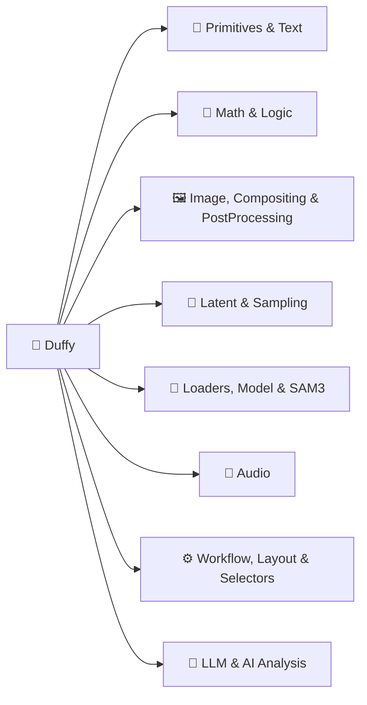

---

### How Interactive "Pause & Edit" Studio Nodes Work

Several flagship nodes in **Duffy Nodes** act as interactive mini-studios right inside your workflow:
- **Real-Time Grading & Shader Processor** *(WebGL2 curves, color wheels, bloom, grain, LUT-style grading)*
- **Interactive Overlay Compositor** *(12-handle gizmo for placing, scaling, rotating, and blending overlays)*
- **Interactive Relighting** *(2D Point, Directional, and Ambient light studio)*
- **Advanced Layer Control** *(Multi-layer Fabric.js composition canvas)*
- **Advanced Image Adjuster** *(Live brightness, contrast, saturation, and hue studio)*
- **Advanced Text Overlay** *(Multi-layer interactive typography compositor)*
- **Advanced Connected Image Stitch** *(Interactive 3×3 grid mapper with live preview)*
- **Gemma Ideogram Spatial Architect** *(Interactive layout & Ideogram 4 JSON prompt studio)*

#### The Interactive Workflow Lifecycle:
1. **Wire the Node:** Connect your upstream `IMAGE` (and optional masks/overlays) into the studio node, and connect its output to `Save Image` or `Image Preview`.
2. **Queue Prompt:** Click **Queue Prompt** as usual. When ComfyUI reaches the studio node, execution **pauses automatically** and displays your live image inside the node (or lets you open the fullscreen modal editor).
3. **Adjust in Real Time:** Dial in your sliders, curves, lighting, or gizmo transforms with instant 60 FPS visual feedback in the browser.
4. **Click "Continue / Apply":** The node sends your exact parameters to the Python backend, which renders the final result at **full tensor resolution on your GPU** and continues the rest of the workflow.
5. **Locking Settings for Batch Runs (`pause_execution` / `pause_mode`):**
   - Every studio node automatically saves your adjustments into the workflow metadata.
   - If you want to run a batch or re-queue without stopping every time, simply toggle **`pause_execution` to `False`** (or set **`pause_mode` to `on_input_change` / `never`**). The node will immediately apply your saved adjustments on the GPU without pausing!

---

### Adding Custom Fonts

The **Image Text Overlay** and **Advanced Text Overlay** nodes automatically detect system fonts on Windows and macOS, plus any custom fonts you provide:
1. Drop any `.ttf`, `.otf`, or `.ttc` font files into `ComfyUI/custom_nodes/Duffy_Nodes/fonts/` (create the `fonts` folder if it does not exist).
2. Refresh your browser or restart ComfyUI — your custom fonts will appear at the top of the `font_name` dropdown.

---

### Setting Up Local LLM Models

To use the GGUF Multimodal Analyzer nodes (`Gemma-4`, `Qwen3.6`, `Qwen3-VL`, `Qwen2.5-Omni`):
1. Create a folder named **`LLM`** inside your `ComfyUI/models/` directory (`ComfyUI/models/LLM/`).
2. Place both the **main quantized model** (`.gguf`) and its matching **multimodal projector** (`mmproj-*.gguf`) inside `ComfyUI/models/LLM/`:
   ```text
   ComfyUI/
   └── models/
       └── LLM/
           ├── gemma-4-E4B-it-Q4_K_M.gguf
           ├── mmproj-gemma-4-e4b-it-f16.gguf
           ├── Qwen3-VL-7B-Instruct-Q4_K_M.gguf
           └── mmproj-Qwen3-VL-7B-Instruct-f16.gguf
   ```
3. Restart ComfyUI (or press **R** in the ComfyUI UI to refresh node definitions) so the dropdowns populate with your downloaded models.

---

## 🛠️ Troubleshooting Common Torch, CUDA & UI Issues

### 1. `"Torch not compiled with CUDA enabled"` or ComfyUI Runs Slowly on CPU
**Cause:** Running `pip install -r requirements.txt` or installing another custom node pack caused `pip` to replace your CUDA-enabled `torch` package with the default CPU-only wheel from PyPI.

**Fix:** Reinstall `torch`, `torchvision`, and `torchaudio` from the official PyTorch CUDA wheel index matching your NVIDIA driver's CUDA support (e.g., `cu126` or `cu124`):
```powershell
# ComfyUI Windows Portable (example for CUDA 12.6):
.\python_embedded\python.exe -m pip install --force-reinstall torch torchvision torchaudio --index-url https://download.pytorch.org/whl/cu126

# Standard venv (example for CUDA 12.6):
pip install --force-reinstall torch torchvision torchaudio --index-url https://download.pytorch.org/whl/cu126
```

### 2. `OSError: [WinError 127] The specified procedure could not be found` or `RuntimeError: Detected that PyTorch and torchvision/torchaudio were compiled with different CUDA versions`
**Cause:** Your `torchvision` or `torchaudio` package was installed for a different PyTorch or CUDA version than your core `torch` package.

**Fix:** First check your `torch.__version__` (see [Step 1](#1-check-your-python-torch--cuda-setup)), then reinstall `torchvision` and `torchaudio` using the exact matching `--index-url`:
```powershell
# Example if your torch.__version__ is 2.5.1+cu124:
.\python_embedded\python.exe -m pip install --force-reinstall torchvision torchaudio --index-url https://download.pytorch.org/whl/cu124
```

### 3. Custom Node UI Widgets Look Blank or Outdated After Updating
**Cause:** The browser cached an older version of the precompiled `web/js/*.js` bundles.

**Fix:** Press **`Ctrl + F5`** (Windows/Linux) or **`Cmd + Shift + R`** (macOS) in your browser to perform a hard cache refresh.

### 4. `ImportError: cannot import name 'Gemma4ChatHandler'` (or `Qwen3VLChatHandler` / `Qwen35ChatHandler`)
**Cause:** Either `llama-cpp-python` was installed into your system Python instead of ComfyUI's `python_embedded`, or the installed version is the outdated PyPI `0.3.20` release.

**Fix:** Check which version ComfyUI's Python sees:
```powershell
.\python_embedded\python.exe -c "import llama_cpp; print(llama_cpp.__version__, llama_cpp.__file__)"
```
Ensure the version is `0.3.36` or `0.3.40+` and reinstall the pre-built wheel from [JamePeng/llama-cpp-python](https://github.com/JamePeng/llama-cpp-python/releases) using `--force-reinstall --no-deps`.

---

## 📚 Complete Node Catalog

### 🔢 Primitive Nodes
Essential input nodes for basic data types with clean, intuitive interfaces.

#### ➕ Dynamic Integer Provider
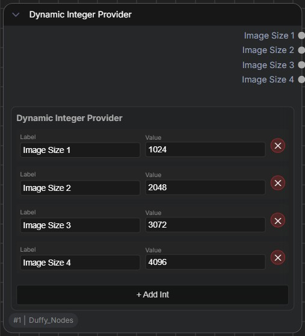
*Category: `Duffy/Primitives`*

A dynamic, multi-port integer provider built with Vue 3. Generates up to 10 outputs on demand interactively. Users can safely add, remove, and custom-label their integer connection ports entirely from the frontend.

**Outputs:** `INT` (`int_1`–`int_10`, dynamically managed)

---

#### ➕ Dynamic Float Provider
*Category: `Duffy/Primitives`*

A dynamic, multi-port floating-point provider (2 decimal places) built with Vue 3. Interactively add, remove, and label up to 10 discrete float outputs directly on the node with deterministic caching.

**Outputs:** `FLOAT` (`float_1`–`float_10`, dynamically managed)

---

#### ➕ Primitive Integer
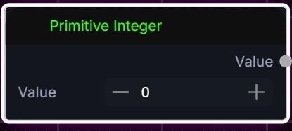
*Category: `Duffy/Primitives`*

Simple integer input with configurable range (-9007199254740991 to 9007199254740991). Perfect for counters, indices, and discrete parameters.

**Outputs:** `INTEGER`

---

#### ➕ Primitive Float  
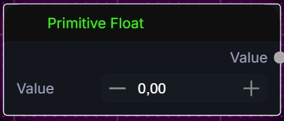
*Category: `Duffy/Primitives`*

Floating-point input with high precision support. Ideal for weights, multipliers, and continuous parameters.

**Outputs:** `FLOAT`

---

#### 📝 Primitive String
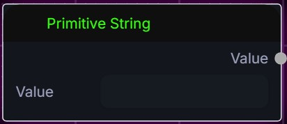
*Category: `Duffy/Primitives`*

Single-line text input for prompts, filenames, and short text snippets.

**Outputs:** `STRING`

---

#### 📄 Primitive String (Multiline)
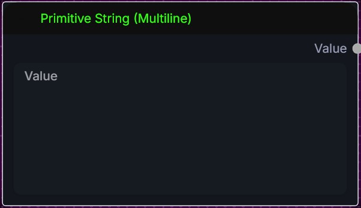
*Category: `Duffy/Primitives`*

Multi-line text editor for complex prompts, descriptions, and formatted text.

**Outputs:** `STRING`

---

#### 🔘 Primitive Boolean
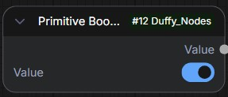
*Category: `Duffy/Logic`*

Simple boolean toggle input (True/False). Perfect for enabling/disabling workflow branches and controlling logic gates.

**Outputs:** `BOOLEAN`

---

### 🔌 Models, Loaders & LoRAs
Advanced tools for loading, routing, patching, and applying machine-learning models.

#### 🔌 Power LoRA Loader
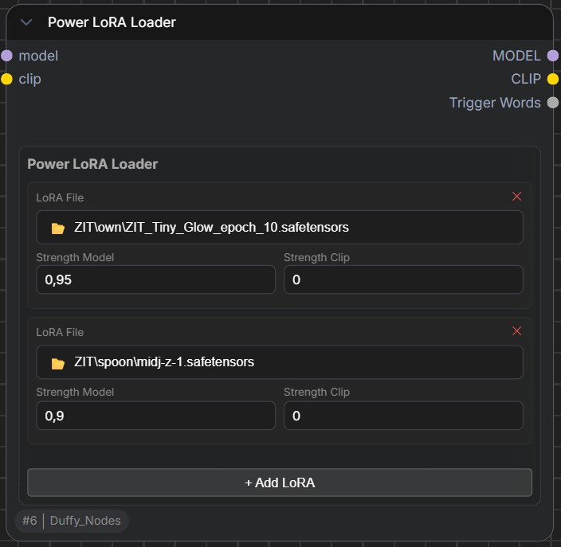
*Category: `Duffy/Model`*

A fully stateless, deterministic, native Vue 3 implementation of dynamic multi-LoRA loading. Bypasses the limitations of legacy LiteGraph canvas rendering, providing Drag-and-Drop capabilities, integrated PrimeVue nested context menus, and strict persistence across workflow reloads. Automatically extracts, aggregates, and passes trigger words to text encoders.

**Inputs:** `model` (MODEL), `clip` (CLIP)  
**Outputs:** `MODEL`, `CLIP`, `TRIGGER_STR`

**Features:**
- Native ComfyUI Vue 3 / Schema V3 Component implementation
- Add, adjust, and reorder an infinite number of LoRAs cleanly
- Deterministic payload caching ensures optimal memory re-use
- Missing LoRAs are handled and bypassed gracefully without crashing the graph
- Automatic extraction and concatenation of Trigger Words

---

#### 🧩 Unified Model Loader
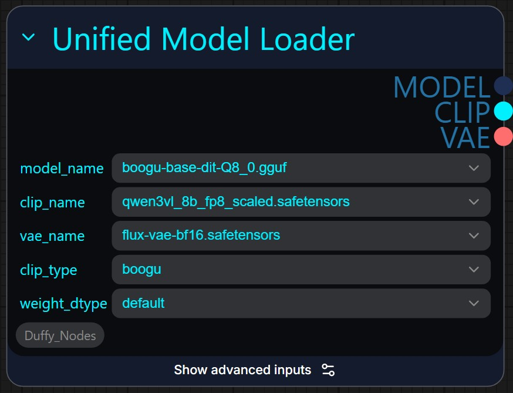
*Category: `Duffy/Loaders`*

All-in-one loader that combines Diffusion model, CLIP text encoder, and VAE selection into one node with support for both `.safetensors` and `.gguf` workflows.

**Inputs:** `model_name` (Diffusion/UNet), `clip_name` (Text Encoder), `vae_name` (VAE), `clip_type` (default or explicit architecture), `weight_dtype` (default/fp8_e4m3fn/fp16), `device` (default/cpu, advanced)  
**Outputs:** `MODEL`, `CLIP`, `VAE`

**Features:**
- Unified loading of model, text encoder, and VAE in one deterministic Schema V3 node.
- Auto-detection and loading logic for mixed standard and quantized GGUF stacks.
- Header-level validation for model/clip/vae files before execution to catch mismatches early.
- Optional CLIP CPU loading and diffusion weight downcast controls for VRAM-sensitive workflows.
- File-signature-aware fingerprinting to invalidate cache when underlying model files change.

---

#### 🔤 Duffy CLIP Loader
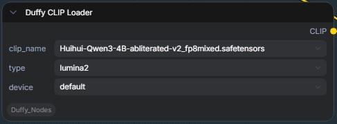
*Category: `Duffy/Loaders`*

Loads CLIP/Text Encoder models for text conditioning. Supports multiple architecture types including Stable Diffusion, SD3, FLUX2, and many others with flexible device placement options.

**Inputs:** `clip_name` (CLIP model file), `type` (architecture type), `device` (CPU/default)  
**Outputs:** `CLIP` (loaded CLIP model)

**Features:**
- Supports 18+ architecture types (SD, SD3, Flux2, Mochi, LTX-V, Cosmos, Qwen, HunyuanImage, etc.)
- CPU offload option for memory-constrained systems
- Intelligent cache fingerprinting based on file modification time
- Stateless V3 Schema implementation with proper error handling

---

#### 📦 Duffy Lora Loader
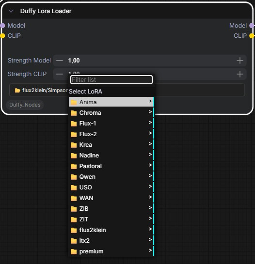
*Category: `Duffy/Loaders`*

Stateless V3 Schema Python node supporting `strength_model` and `strength_clip`. Bypasses native V3 searchable flat dropdowns using a custom Vue 3 widget mapped to `LiteGraph.ContextMenu` to preserve hierarchical folder structures.

**Inputs:** `model` (Model), `clip` (CLIP), `lora_name` (String: hidden), `strength_model` (Float), `strength_clip` (Float)  
**Outputs:** Modified `model` (Model), Modified `clip` (CLIP)

---

### 🎯 SAM3 Nodes
Interactive annotation and prompt-conditioning tools for SAM3-driven mask workflows.

#### 🖌️ SAM3 Mask Editor
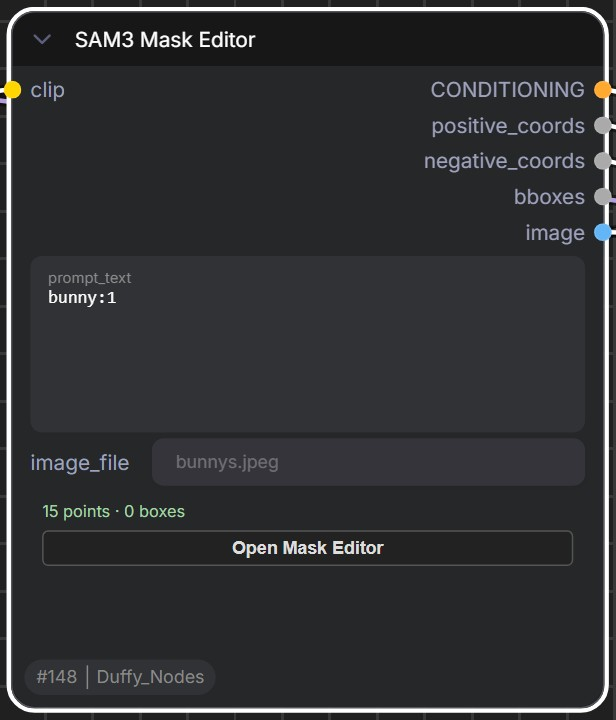
*Category: `Duffy/SAM3`*

Unified CLIP encoder and interactive SAM3 mask editor with modal image loading, positive/negative point placement, and bounding box annotation for SAM3 Detect pipelines.

**Inputs:** `clip` (CLIP), `image_file` (hidden widget), `prompt_text` (STRING), `internal_bboxes` (hidden JSON), `internal_coords` (hidden JSON), `internal_negative_coords` (hidden JSON), `internal_resize_meta` (hidden JSON)  
**Outputs:** `CONDITIONING`, `positive_coords` (STRING), `negative_coords` (STRING), `bboxes` (BOUNDING_BOX), `image` (IMAGE)

**Features:**
- Fullscreen interactive mask editor modal with pan/zoom canvas controls
- Positive and negative point annotation support for SAM3 prompts
- Bounding box authoring with resize/translate/select/delete tooling
- Safe upload flow to ComfyUI input directory via `/duffy/sam3/upload_image`
- Annotation and resize metadata persistence across workflow save/load
- Integrated CLIP tokenization and conditioning output in a single node

---

### 🧮 Math & Slider Nodes
Powerful mathematical nodes and multi-parameter slider banks for precise numerical control.

#### ➗ Float Math
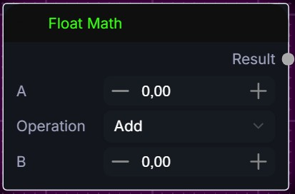
*Category: `Duffy/Math`*

Perform arithmetic operations on floating-point values. Supports addition, subtraction, multiplication, division, power, and modulo.

**Inputs:** `a` (float), `b` (float), `operation` (dropdown)  
**Outputs:** `result` (float)

---

#### ✖️ Integer Math
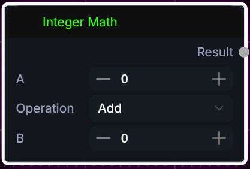
*Category: `Duffy/Math`*

Integer-based mathematical operations with floor division support. Perfect for discrete calculations and index manipulation.

**Inputs:** `a` (int), `b` (int), `operation` (dropdown)  
**Outputs:** `result` (int)

---

#### 📐 Math Expression
*Category: `Duffy/Math`*

Evaluates custom mathematical expressions using variables `a`, `b`, and `c` (including standard functions and constants like `sin`, `cos`, `sqrt`, `min`, `max`, `pi`) and outputs both integer and floating-point results simultaneously.

**Inputs:** `a` (float), `b` (float), `c` (float), `expression` (string)  
**Outputs:** `Int Result` (INT), `Float Result` (FLOAT)

---

#### 🎛️ Five Dynamic Sliders
*Category: `Duffy/Math`*

Interactive Vue 3 slider bank providing five floating-point sliders where each slider's **label**, **min**, **max**, **step**, and **decimal precision** can be customized directly in the node UI.

**Outputs:** `out_1`, `out_2`, `out_3`, `out_4`, `out_5` (FLOAT)

---

#### 🎛️ Five Float Sliders
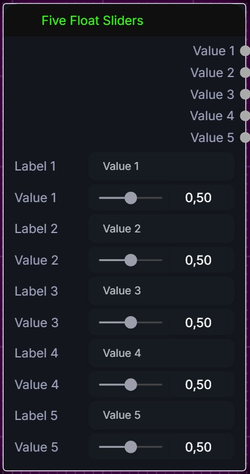
*Category: `Duffy/Math`*

Five independent float sliders (0.0–100.0) with custom UI widget. Ideal for multi-parameter experimentation and fine-tuning.

**Outputs:** `float_1`, `float_2`, `float_3`, `float_4`, `float_5`

---

#### 🎚️ Five Int Sliders
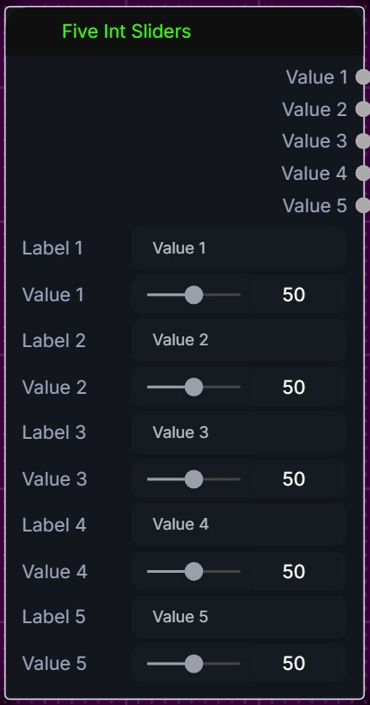
*Category: `Duffy/Math`*

Five independent integer sliders (0–100) with synchronized UI. Perfect for batch processing controls and discrete parameter sweeps.

**Outputs:** `int_1`, `int_2`, `int_3`, `int_4`, `int_5`

---

#### 🎛️ Seven Float Sliders / Seven Wide Float Sliders / Seven Int Sliders
*Category: `Duffy/Math`*

Three 7-channel customizable slider banks with user-editable labels (`Label 1`–`Label 7`) for large multi-parameter workflows:
- **Seven Float Sliders:** Fine `0.01`–`1.00` range (step `0.01`), ideal for LoRA weights, blending ratios, and denoise sweeps.
- **Seven Wide Float Sliders:** Extended `0.0`–`15.0` range (step `0.1`), ideal for CFG scales, guidance multipliers, and shift values.
- **Seven Int Sliders:** Discrete `1`–`100` integer range (step `1`), ideal for step counts, batch sizes, and index controls.

**Outputs:** `out_1` through `out_7` (`FLOAT` or `INT`)

---

### 🧠 Logic Operations
Perform boolean logic, integer comparisons, and conditional routing.

#### 🧩 Logic Gate
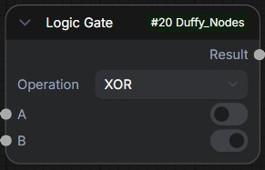
*Category: `Duffy/Logic`*

Perform boolean logical operations on inputs. Supports standard gates including AND, OR, NOT, NAND, NOR, XOR, and XNOR.

**Inputs:** `a` (boolean), `b` (boolean, optional), `operation` (dropdown)  
**Outputs:** `result` (boolean)

---

#### ⚖️ Integer Compare
*Category: `Duffy/Logic`*

Compares two integer values (`A` and `B`) using a `Less Than (<)` or `Greater Than (>)` condition, outputting both the winning integer value and the boolean comparison result. Useful for resolution checks (e.g., portrait vs. landscape detection).

**Inputs:** `a` (INT), `condition` (`Less Than (<)` / `Greater Than (>)`), `b` (INT)  
**Outputs:** `Value` (INT), `Result` (BOOLEAN)

---

### 🖼️ Image Processing, Compositing & Grading
Advanced image manipulation, interactive compositing, and real-time GPU color grading nodes.

#### 🎬 Real-Time Grading & Shader Processor
*Category: `Duffy/Image/PostProcessing`*

Interactive human-in-the-loop color grading and post-processing shader suite. Pauses the workflow to display a compact node preview card with one-click launch into a **fullscreen WebGL2 Studio Editor**, then renders the final graded batch at full tensor resolution on the GPU.

**Inputs:** `image` (IMAGE), `pause_mode` (`always` / `on_input_change` / `never`), `overall_strength` (0.0–1.0), `grading_state` (hidden JSON state), `mask` (MASK, optional)  
**Outputs:** `Image` (IMAGE), `Grading JSON` (STRING)

**Features:**
- 🎨 **Full Grading Suite** — Interactive RGB/channel spline curves, White Balance (Temperature/Tint), Exposure/Contrast/Saturation, Shadows/Highlights, Lift/Gamma/Gain color wheels, and multi-stop Gradient Maps (with 5 blend modes).
- ✨ **Post-FX Shaders** — Real-time Bloom, Chromatic Aberration, Unsharp Masking (Sharpening), Vignette, and procedural Film Grain.
- ⚡ **WebGL2 ↔ PyTorch Parity** — Identical shader math between the 60 FPS browser studio and the GPU PyTorch backend.
- 🎭 **Optional Masking & Strength** — Blend the graded image against the original using `overall_strength` and an optional `MASK`.

---

#### 🎨 Image Adjuster
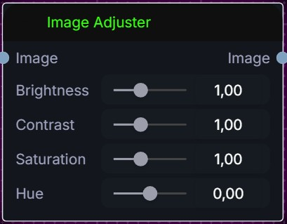
*Category: `Duffy/Image`*

Professional-grade color correction tool. Adjust brightness, contrast, saturation, and hue with GPU-accelerated torchvision transforms.

**Inputs:** `image` (IMAGE), `brightness` (0.0–3.0), `contrast` (0.0–3.0), `saturation` (0.0–3.0), `hue` (-0.5–0.5)  
**Outputs:** `IMAGE`

---

#### 🎨 Advanced Image Adjuster
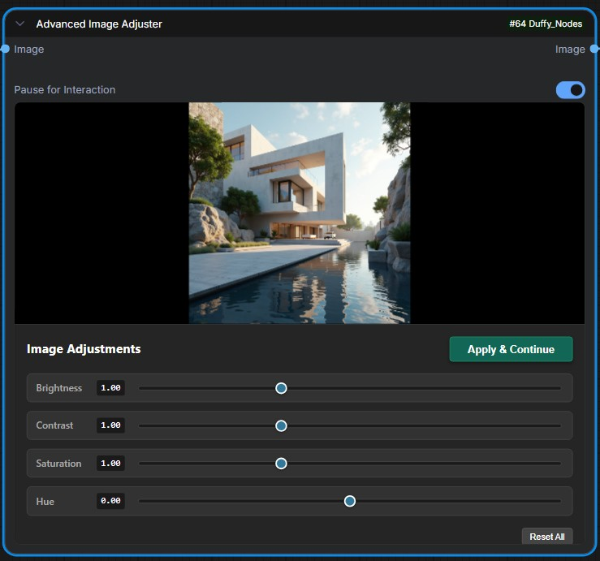
*Category: `Duffy/Image`*

Interactive post-processing node that pauses your workflow to allow real-time image adjustment. Dial in the perfect look with a live preview before continuing the execution.

**Inputs:** `image` (IMAGE), `pause_execution` (boolean), `saved_adjustments` (hidden JSON state)  
**Outputs:** `image` (IMAGE)

**Features:**
- ⏸️ **Workflow Pausing** — Execution stops at the node, revealing an interactive adjustment studio.
- 📺 **Live Preview** — See your changes instantly with a responsive CSS-filtered preview that mirrors the backend math.
- 🎛️ **Precise Sliders** — Fine-tune brightness (0.0–3.0), contrast (0.0–3.0), saturation (0.0–3.0), and hue (-0.5–0.5).
- ⚡ **Pure PyTorch Backend** — Final adjustments are computed using optimized tensor operations without external dependencies.
- 🔄 **Double-Click Reset** — Quickly reset individual sliders to their default values with a double-click.

---

#### 📐 Megapixel Resize
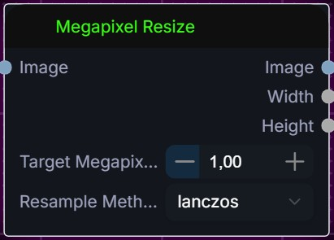
*Category: `Duffy/Image`*

Intelligent image resizer targeting specific megapixel counts while preserving aspect ratio. Perfect for consistent resolution workflows.

**Inputs:** `image` (IMAGE), `target_megapixels` (float), `mode` (dropdown: Bilinear, Nearest, Bicubic, Area, Lanczos)  
**Outputs:** `IMAGE`, `width` (int), `height` (int)

---

#### 📂 Load Image & Resize
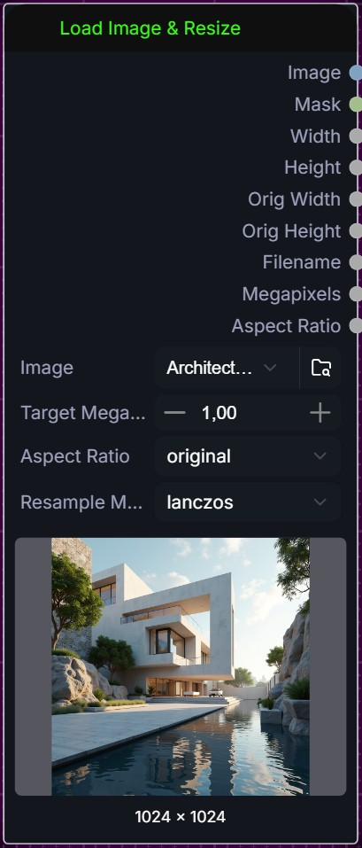
*Category: `Duffy/Image`*

Combined image loader, interactive cropper, and intelligent resizer. Loads images, optionally crops them via a fullscreen visual editor, and resizes to target megapixels — all in one node.

**Inputs:** `image` (file picker), `target_megapixels` (float), `aspect_ratio` (dropdown), `method` (dropdown), `divisible_by` (int), `crop_data` (hidden JSON state)  
**Outputs:** `IMAGE`, `MASK`, `width` (int), `height` (int), `original_width` (int), `original_height` (int), `filename` (string), `megapixels` (float), `aspect_ratio` (string)

**Features:**
- ✂️ **Interactive Crop Editor** — A "✂ Crop Image" button opens a fullscreen modal overlay powered by Cropper.js for precise visual cropping.
- 📐 **Aspect Ratio Presets** — Lock the crop selection to common ratios (Free, 1:1, 4:3, 3:4, 3:2, 2:3, 16:9, 9:16, 21:9, 9:21).
- 📏 **Live Dimension Readout** — See the exact pixel dimensions and position of your crop in real-time.
- 🔄 **Auto-Reset on Image Change** — Crop coordinates are automatically cleared when a new image is selected.
- 🎯 **Non-Destructive Pipeline** — Crop $\rightarrow$ center-crop to aspect ratio $\rightarrow$ megapixel resize.

---

#### 🎭 RGBA to RGB (Lossless)
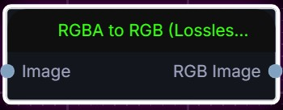
*Category: `Duffy/Image`*

Convert 4-channel RGBA image tensors to 3-channel RGB by stripping or compositing the alpha channel cleanly without recompression artifacts.

**Inputs:** `image` (IMAGE)  
**Outputs:** `IMAGE`

---

#### 💾 Save Image with Sidecar TXT
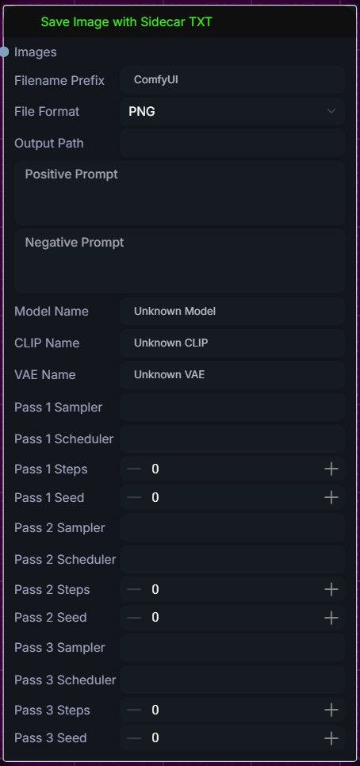
*Category: `Duffy/IO`*

Save images along with companion `.txt` / JSON metadata sidecar files. Ideal for dataset curation, LoRA training caption generation, and tracking generation parameters.

**Inputs:** `images` (IMAGE), `filename_prefix` (string), caption/metadata inputs  
**Outputs:** Saved image files + sidecar text/metadata files

---

#### 📁 Directory Image Iterator & 🏷️ Iterator Current Filename
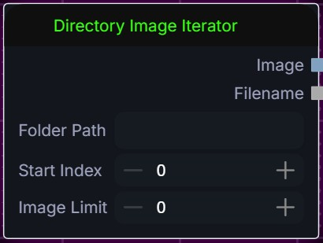
*Category: `Duffy/Image`*

Iterate through images in a directory with automatic batching and extract the current filename for downstream naming or sidecar saving.

**Inputs:** `directory` (string), `index` (int), `recursive` (boolean)  
**Outputs:** `IMAGE`, `filename` (string), `total_count` (int)

---

#### 🖼️ Image Preview
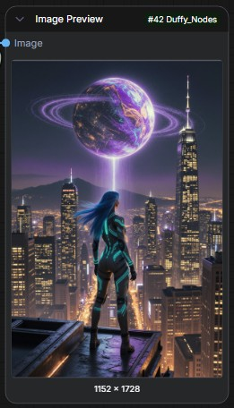
*Category: `Duffy/Image`*

Simple stateless V3 image preview node that displays an image batch natively within the node.

**Inputs:** `image` (IMAGE)  
**Outputs:** *(Visual endpoint)*

---

#### 🔍 Image Compare
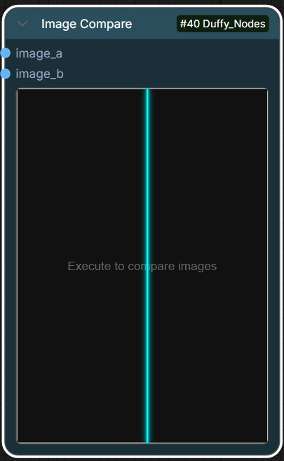
*Category: `Duffy/Image`*

Interactively compare two images with a vertical, laser-sharp slider that tracks your mouse position. Perfect for A/B testing upscalers, samplers, LoRAs, or color grading.

**Inputs:** `image_a` (IMAGE), `image_b` (IMAGE)  
**Outputs:** *(Visual endpoint)*

---

#### 🔍 Duffy Advanced Folder Image Selector
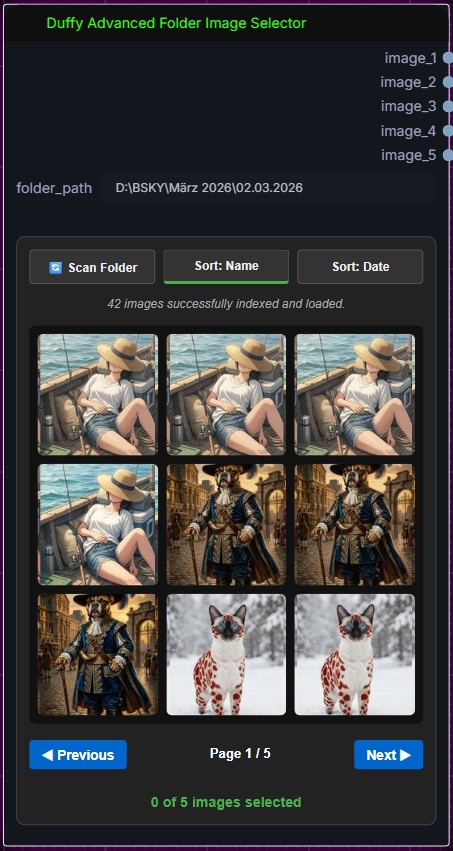
*Category: `Duffy/Image`*

Interactive 3×3 paginated thumbnail browser for selecting up to 10 images from a local directory, with sorting by filename or date and persistent selection state.

**Inputs:** `folder_path` (string), `selected_images_state` (string, hidden)  
**Outputs:** `image_1` through `image_10` (IMAGE)

---

#### 🧩 Image Stitch / 🔗 Connected Image Stitch / 🔗 Advanced Connected Image Stitch
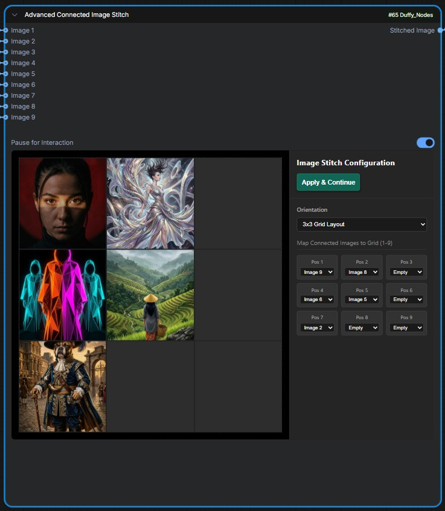
*Category: `Duffy/Image`*

Three versatile 3×3 image stitching nodes supporting **Horizontal** (height-matched), **Vertical** (width-cropped), and **3×3 Grid Layout** modes with Lanczos resampling:
- **Duffy Image Stitch:** Upload up to 9 images directly inside the node and reorder them via drag-and-drop.
- **Duffy Connected Image Stitch:** Connect up to 9 upstream `IMAGE` outputs and map them to any 3×3 cell.
- **Advanced Connected Image Stitch:** Pauses workflow execution to open an interactive 3×3 stitching studio with live preview before rendering the final composite.

**Outputs:** `stitched_image` (IMAGE)

---

#### 🔠 Image Text Overlay & 🧾 Advanced Text Overlay
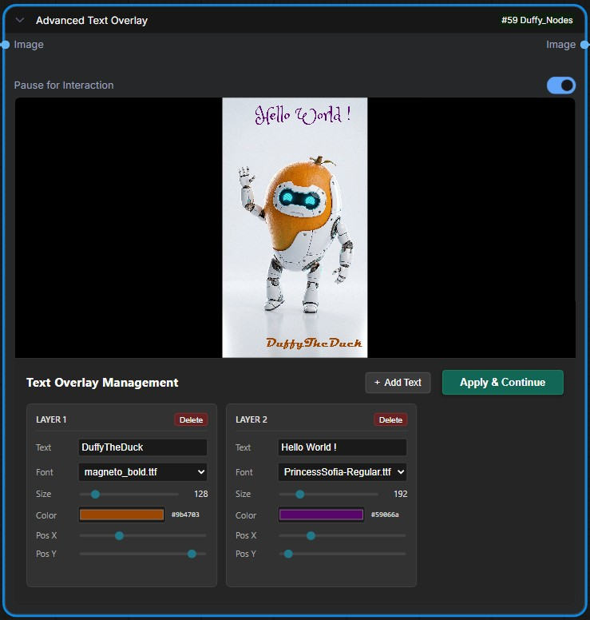
*Category: `Duffy/Image`*

Render crisp typography over images using system fonts or custom `.ttf`/`.otf`/`.ttc` files from the `fonts/` folder:
- **Image Text Overlay:** Stateless single-layer text overlay with HTML5 color picker, font size slider, and X/Y placement.
- **Advanced Text Overlay:** Interactive multi-layer text studio that pauses execution so you can add, drag, style, and preview multiple text blocks live on the canvas.

**Outputs:** `image` (IMAGE)

---

#### 💡 Interactive Relighting
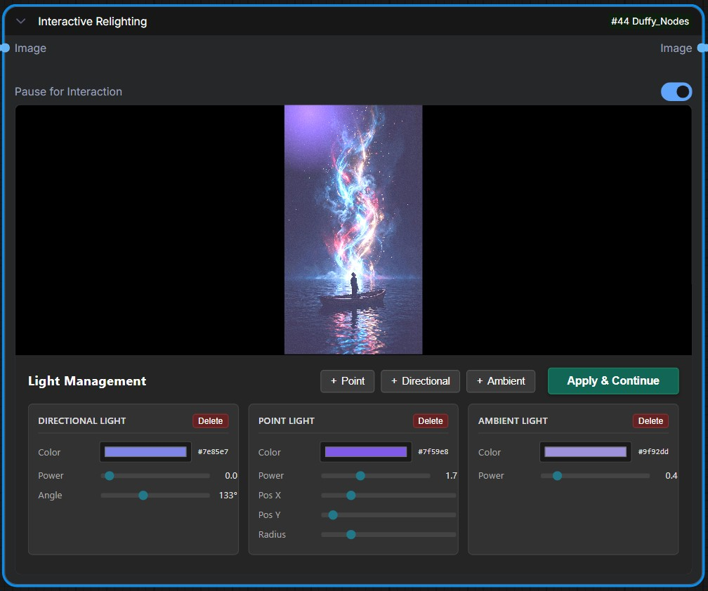
*Category: `Duffy/Image`*

Pause your workflow and interactively relight your images in real-time. Add multiple 2D light sources — **Point** (radial falloff), **Directional** (linear gradient), and **Ambient** — and manipulate position, color, radius, and intensity directly on the canvas preview.

**Inputs:** `image` (IMAGE), `pause_execution` (boolean), `saved_lights` (hidden JSON state)  
**Outputs:** `image` (IMAGE)

---

#### 🎛️ Advanced Layer Control
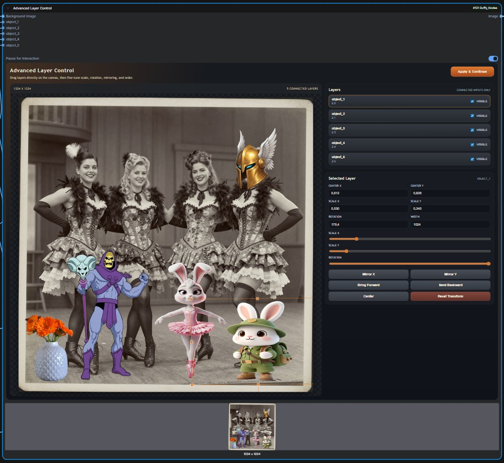
*Category: `Duffy/Image`*

Pause your workflow to interactively compose up to five distinct object layers (`object_1`–`object_5`) over a `background_image` using an interactive Fabric.js canvas with position, scale, rotation, flip, visibility, and Z-order controls.

**Inputs:** `background_image` (IMAGE), `object_1`–`object_5` (IMAGE, optional), `pause_execution` (boolean), `saved_layers` (hidden JSON state)  
**Outputs:** `image` (IMAGE)

---

#### 🧩 Interactive Overlay Compositor
*Category: `Duffy/Image/Compositing`*

Pause the workflow and place an RGBA overlay over a background **directly inside the node** using a 12-handle transform gizmo (move with center-axis snapping, uniform/free/edge scale, rotation, and movable pivot), then click **Continue** to composite on the GPU with bicubic premultiplied-alpha resampling.

**Inputs:** `background_image` (IMAGE), `overlay_image` (IMAGE, RGBA supported), `blend_mode` (`normal` / `multiply` / `screen` / `overlay` / `add`), `opacity` (0–1), `pause_mode` (`always` / `on_input_change` / `never`), `transform_state` (hidden JSON state)  
**Outputs:** `IMAGE` (composite), `MASK` (overlay footprint), `TRANSFORM_DATA` (JSON)

---

### 🎵 Audio Operations
Utilities for inspecting and trimming ComfyUI `AUDIO` waveforms.

#### ⏱️ Audio Duration
*Category: `Duffy/Audio`*

Calculates and outputs the exact duration of an input ComfyUI `AUDIO` waveform in milliseconds (both as a float and a rounded integer), making it easy to synchronize video frame counts or animation schedules to audio length.

**Inputs:** `audio` (AUDIO)  
**Outputs:** `Duration (ms)` (FLOAT), `Duration ms (int)` (INT)

---

#### ✂️ Audio Slicer
*Category: `Duffy/Audio`*

Slices a segment from an `AUDIO` input using human-readable start and end timestamp strings (`SS`, `SS.s`, `MM:SS`, or `HH:MM:SS`, e.g., `0:30` to `1:15.5`). Essential for trimming long audio tracks before passing them to video generators or multimodal LLM analyzers.

**Inputs:** `audio` (AUDIO), `start_time` (STRING), `end_time` (STRING)  
**Outputs:** `Modified Audio` (AUDIO)

---

### 🎲 Latent Operations
Specialized nodes for latent space manipulation, resolution calculation, and noise generation.

#### 🎛️ Adaptive Resolution & Latent Heatsink
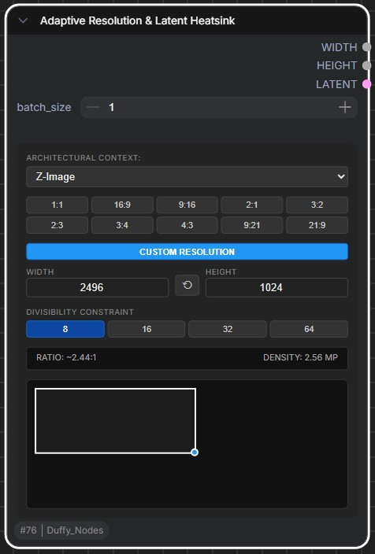
*Category: `Duffy/Latent`*

Advanced interactive Vue 3 resolution calculator mapping directly to architectural divisibility constraints (`8`, `16`, `32`, `64`) for SD 1.5, SDXL, Qwen, Z-Image, and Flux series models. Offers both preset aspect ratios and custom draggable 1:12 scale bounding boxes.

**Inputs:** `batch_size` (int), `state_json` (hidden JSON state)  
**Outputs:** `WIDTH` (INT), `HEIGHT` (INT), `LATENT` (LATENT)

---

#### 📦 Empty Qwen-2512 Latent Image
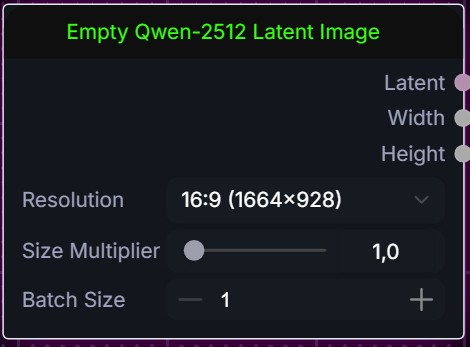
*Category: `Duffy/Latent`*

Initializes an empty 16-channel latent tensor optimized for the Qwen-Image-2512 architecture, complete with aspect-ratio presets, a resolution multiplier slider, and automatic 16 px alignment.

**Inputs:** `resolution` (dropdown), `size_multiplier` (float), `batch_size` (int)  
**Outputs:** `LATENT`, `width` (INT), `height` (INT)

---

#### 🌊 Generate Noise (Flux 2 Klein)
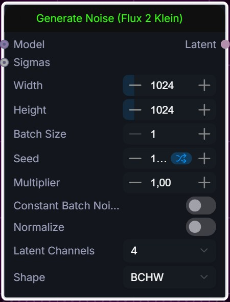
*Category: `Duffy/Latent`*

Advanced noise generator for Flux and Klein architectures supporting 4/16-channel f8, 64-channel f16, and 128-channel f16 spatial downsampling with strict divisibility validation and batch-consistent seeding.

**Inputs:** `latent` / dimensions, `seed` (int), channel & architecture controls  
**Outputs:** `LATENT` / `NOISE`

---

#### 🎭 Latent Noise Blender
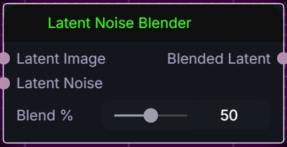
*Category: `Duffy/Latent`*

Blend two latent tensors with a configurable mixing ratio for latent interpolation and noise injection workflows.

**Inputs:** `latent_a` (LATENT), `latent_b` (LATENT), `blend_factor` (0.0–1.0)  
**Outputs:** `LATENT`

---

### 🎯 Sampling & Scheduling
Advanced sampling control nodes for fine-grained generation control.

#### 🧠 Dynamic Multi-Architecture Sampler
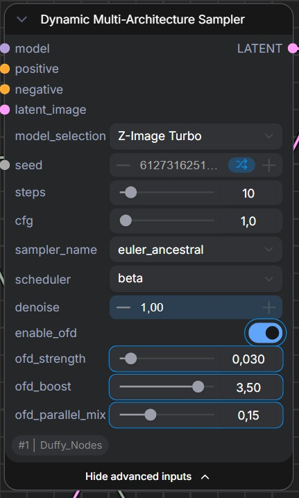
*Category: `Duffy/Sampling`*

Full sampler executor that adapts generation behavior to modern foundation and distilled model families (Z-Image Base/Turbo, Qwen-Image-2512, Flux.2-Klein-Base/Klein, Ernie-Image Base/Turbo) using one architecture profile dropdown. Automatically updates step limits in the UI and enforces numerically stable CFG for distilled profiles.

**Inputs:** `model` (MODEL), `model_selection` (combo), `seed` (int), `steps` (int), `cfg` (float), `sampler_name` (combo), `scheduler` (combo), `positive` (CONDITIONING), `negative` (CONDITIONING), `latent_image` (LATENT), `denoise` (0.0–1.0), `enable_ofd` (boolean)  
**Outputs:** `LATENT`

---

#### 📈 Flux Max Shift
*Category: `Duffy/Sampling`*

Calculates the `max_shift` parameter (`(width * height * multiplier) / divisor`) for `ModelSamplingFlux` in a single compact node, replacing multi-node math subgraphs (such as Chroma Radiance shift calculation).

**Inputs:** `width` (INT), `height` (INT), `multiplier` (FLOAT), `divisor` (INT)  
**Outputs:** `max_shift` (FLOAT)

---

#### 🔀 Triple Sampler & Scheduler Selector
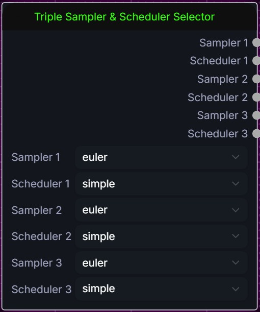
*Category: `Duffy/Sampling`*

Select three independent sampler + scheduler combinations simultaneously for side-by-side comparison and XY grid testing.

**Outputs:** `Sampler 1`, `Scheduler 1`, `Sampler 2`, `Scheduler 2`, `Sampler 3`, `Scheduler 3`

---

#### 🎪 Multi-Pass Sampling
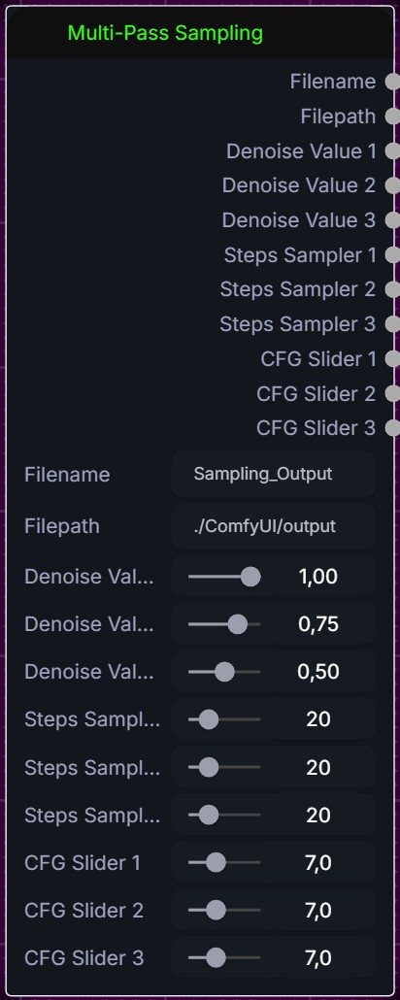
*Category: `Duffy/Sampling`*

Execute multiple sampling passes with different parameters in sequence for iterative refinement workflows.

**Inputs:** `latent` (LATENT), `passes` (int), `steps_per_pass` (int)  
**Outputs:** `LATENT`

---

### 🔧 Selectors, Text & Utilities
Workflow helpers for routing, prompt authoring, rich documentation, and debugging.

#### 👁️ Show Anything
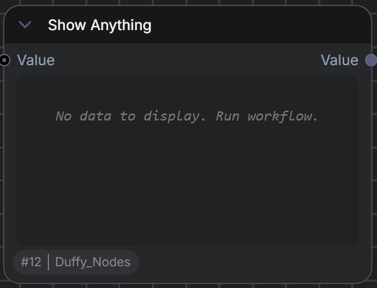
*Category: `Duffy/Utils`*

Displays any connected value (strings, numbers, booleans, arrays, or dictionaries formatted as JSON) directly on the node in a scrollable Vue 3 panel while passing the value through to downstream nodes.

**Inputs:** `value` (AnyType)  
**Outputs:** `value` (AnyType)

---

#### 📓 Rich Text Note
*Category: `Duffy/Text`*

A rich-text documentation and note node with a full WYSIWYG editor modal supporting bold, italic, headings, lists, text colors, links, and icons. Stores sanitized HTML in the workflow while outputting clean plain text (HTML stripped) for downstream prompt or LLM nodes.

**Outputs:** `Text` (STRING)

---

#### 💬 Prompt Box
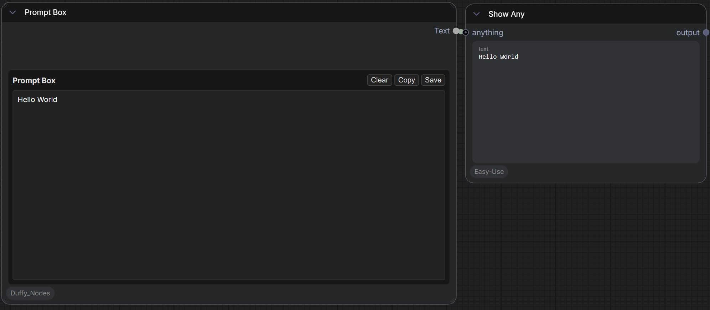
*Category: `Duffy/Text`*

Spacious multiline text editor with one-click **Copy**, **Clear**, and **Save to File** buttons, plus an optional external string input override.

**Inputs:** `optional_input` (STRING, optional)  
**Outputs:** `text` (STRING)

---

#### 📚 Prompt Loader
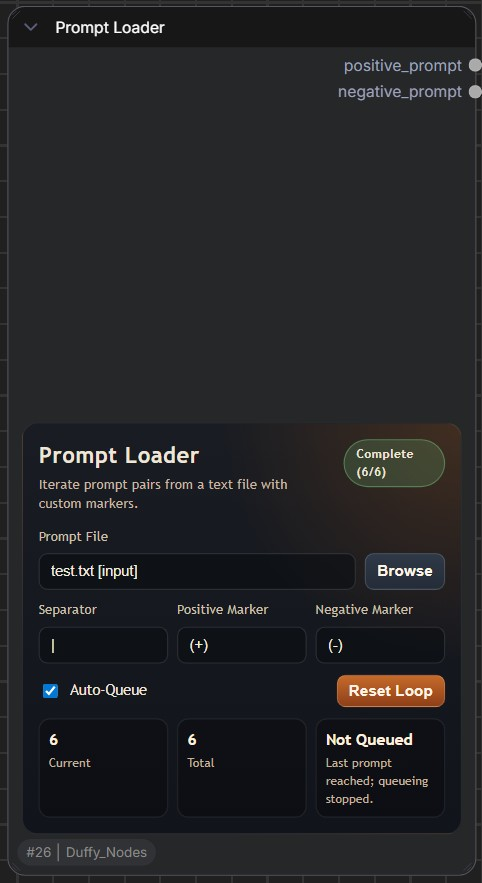
*Category: `Duffy/Text`*

Loads batches of positive/negative prompt pairs from `.txt`, `.csv`, or `.md` files using customizable markers (`(+)`, `(-)`, `|`) and emits one pair per run. Includes an **Auto-Queue** mode and a Vue 3 status panel to automatically run through every prompt in the file.

**Inputs:** `file_path` (STRING), `separator` (STRING), `positive_marker` (STRING), `negative_marker` (STRING), `auto_queue` (BOOLEAN), `reset_counter` (INT)  
**Outputs:** `positive_prompt` (STRING), `negative_prompt` (STRING)

---

#### ✂️ Prompt Splitter
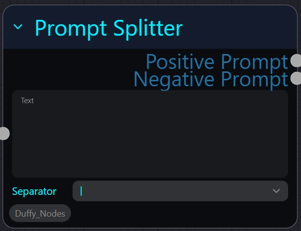
*Category: `Duffy/Text`*

Splits a combined prompt string into separate `positive` and `negative` outputs on the first occurrence of a chosen separator (`|`, `,`, `;`, `\n`, `---`, `__`).

**Inputs:** `text` (STRING), `separator` (combo)  
**Outputs:** `positive` (STRING), `negative` (STRING)

---

#### 🔎 Find and Replace Text
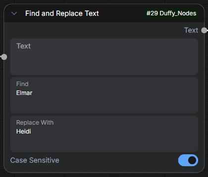
*Category: `Duffy/Text`*

Performs case-sensitive or case-insensitive literal find-and-replace across single-line or multiline strings.

**Inputs:** `text` (STRING), `find_text` (STRING), `replace_with` (STRING), `case_sensitive` (BOOLEAN)  
**Outputs:** `text` (STRING)

---

#### 📝 JSON Format String
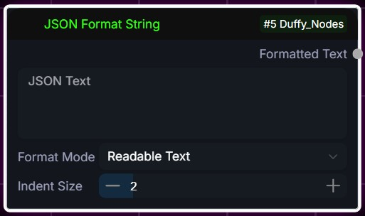
*Category: `Duffy/utilities`*

Parses raw JSON strings and formats them either as **Pretty JSON** (indented) or **Readable Text** (human-friendly labeled sections).

**Inputs:** `json_text` (STRING), `format_mode` (dropdown), `indent_size` (1–8)  
**Outputs:** `formatted_text` (STRING)

---

#### 🎲 Seed
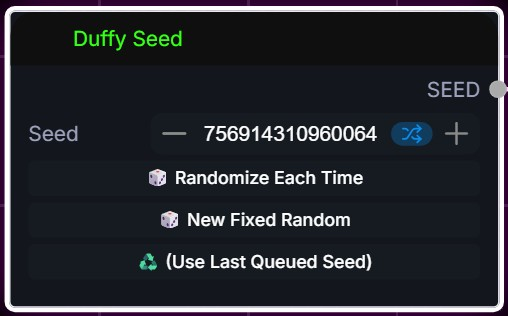
*Category: `Duffy/utilities`*

Advanced seed controller with dedicated UI buttons for **Randomize Each Time**, **New Fixed Random**, **Use Last Queued Seed**, and increment/decrement modes, intercepting the prompt on the frontend for full reproducibility.

**Inputs:** `seed` (INT)  
**Outputs:** `SEED` (INT)

---

#### 📡 Signal Selector & 🔀 Toggle Switch
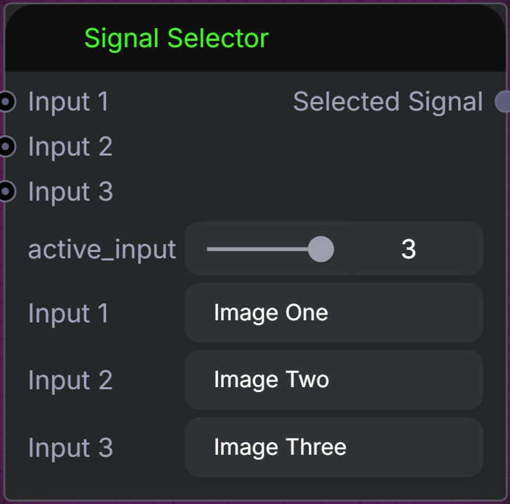
*Category: `Duffy/Selectors`*

Universal wildcard (`*`) routing nodes:
- **Signal Selector:** Routes 1 of 5 arbitrary inputs (`input_1`–`input_5`) to the output based on a selector index.
- **Toggle Switch:** Clean boolean A/B switch between `input_a` and `input_b`.

---

#### 📂 Model Selector & 🏷️ LoRA Prompt Combiner
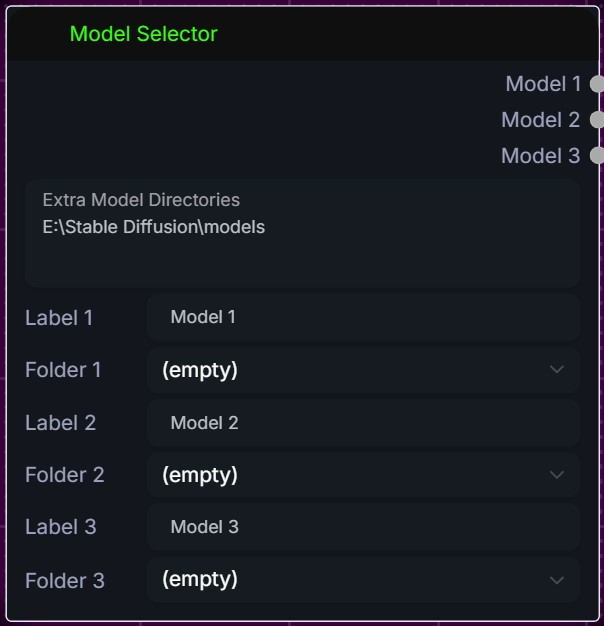
*Category: `Duffy/Selectors` & `Duffy/Utilities`*

- **Model Selector:** Scans a custom models directory and populates dropdowns for Diffusion, CLIP, and VAE model paths with path-traversal protection.
- **LoRA Prompt Combiner:** Combines base prompts with `<lora:name:weight>` tags (Prepend, Append, or Replace).

---

### ⚙️ Workflow & Group Control
Nodes designed to manage and optimize your ComfyUI canvas execution flow without hunting across large graphs.

#### 🔕 Native Group Muter & ⏭️ Native Group Bypasser
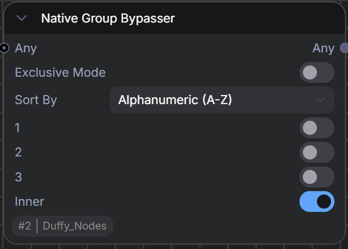
*Category: `Duffy/Workflow`*

Auto-updating multi-toggle controllers that list all groups on your canvas alphabetically, allowing you to mute or bypass any combination of groups (with optional **Exclusive Mode** for instant A/B branch switching).

---

#### 🔕 Native Single Group Muter & ⏭️ Native Single Group Bypasser
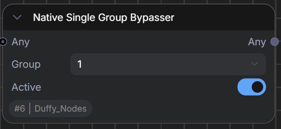
*Category: `Duffy/Workflow`*

Compact dropdown controllers targeting a single canvas group with a master Active/Inactive switch.

---

### 📐 Layout
Frontend utilities for organizing the ComfyUI workspace.

#### 📏 Spatial Alignment Matrix
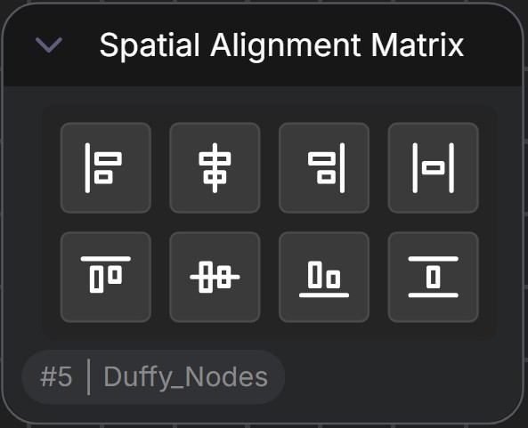
*Category: `Duffy/Layout`*

A pure-frontend layout utility node (auto-bypassed during execution) and Nodes 2.0 Selection Toolbox extension for aligning selected nodes (Top, Bottom, Left, Right, Center-H, Center-V) and distributing them evenly (Horizontal/Vertical spacing).

---

### 🤖 LLM & AI Analysis
Local hardware-accelerated multimodal AI analysis, reverse-captioning, spatial layout planning, and system prompt engineering using GGUF models in `ComfyUI/models/LLM/`.

> [!NOTE]
> All GGUF execution nodes below require a pre-built CUDA wheel of **`llama-cpp-python`** — see **[Section 4: Optional GGUF LLM Setup](#4-optional-installing-llama-cpp-python-for-local-gguf-llm-nodes)** and **[docs/llm_node_setup.md](docs/llm_node_setup.md)**.

#### 🧭 Vision-LLM System Prompt Selector
*Category: `Duffy/LLM`*

Selects a target Diffusion Transformer architecture (**Krea-2**, **MOSS-Image**, **FLUX 3 Image Klein**, or **Qwen-Image-2.1**) and conditioning task (**Text-to-Image Prompt Enhancement**, **Image-to-Prompt Reverse Captioning**, or **Image Editing & Reference Conditioning**), outputting both the research-tuned `System Prompt` and the recommended VLM decoding hyperparameters (`Enable Thinking`, `Temperature`, `Top P`, `Top K`, `Presence Penalty`, `Max Tokens`) ready to wire directly into any analyzer node.

**Inputs:** `model` (dropdown), `use_case` (dropdown)  
**Outputs:** `System Prompt` (STRING), `Enable Thinking` (BOOLEAN), `Temperature` (FLOAT), `Top P` (FLOAT), `Top K` (INT), `Presence Penalty` (FLOAT), `Max Tokens` (INT)

---

#### 🎨 Image Styler

*Category: `Duffy/LLM`*

A style-locked system-prompt generator with an adaptive Vue 3 thumbnail preview. Select from dozens of curated visual styles and feed the generated `system_prompt` into any LLM analyzer node to enforce consistent artistic direction and pure prompt-only output.

**Inputs:** `style` (dropdown)  
**Outputs:** `system_prompt` (STRING)

---

#### 🧠 Gemma-4 12B GGUF Multimodal Analyzer & Gemma-4 GGUF Multimodal Analyzer (E4B)

*Category: `Duffy/LLM`*

Local multimodal analyzers powered by Google's **Gemma-4-12B-it** (`gemma4uv` unified architecture) and **Gemma-4-E4B-it** models via `llama.cpp`. Analyze **Text**, **Images**, **Reference Style Images**, **Video batches** (auto-sampled up to 30 frames), and **Audio waveforms** (auto-resampled to 16 kHz mono) in a single pass with up to 128K context, Thinking mode, and built-in Reverse-Engineered / Style-Transfer presets.

**Inputs:** `gguf_model`, `mmproj_model`, `system_prompt`, `user_prompt`, `image` (optional), `reference_image` (optional), `video` (optional), `audio` (optional), plus full sampling & VRAM offload controls (`n_gpu_layers`, `n_ctx`, `unload_model`, etc.)  
**Outputs:** `analysis_text` (STRING)

---

#### 🏛️ Gemma Ideogram Spatial Architect
*Category: `Duffy/LLM`*

Combines **Gemma-4-12B** multimodal intelligence with an interactive pause-and-edit **Spatial Layout Studio** to analyze sketches/layouts and construct validated, structured **Ideogram 4 JSON prompts** (complete with spatial bounding regions, typography hierarchies, and color palettes).

**Inputs:** `gguf_model`, `mmproj_model`, `text_prompt`, `pause_execution`, `enable_thinking`, `image` (optional sketch/layout), `preview_image` (optional)  
**Outputs:** `JSON Prompt` (STRING)

---

#### 👁️ Qwen3.6 GGUF Multimodal Analyzer & Qwen3-VL GGUF Multimodal Analyzer
*Category: `Duffy/LLM`*

High-precision vision-language analyzers powered by **Qwen3.6 (`Qwen35ChatHandler`)** and **Qwen3-VL (`Qwen3VLChatHandler`)** via `llama.cpp`. Support single-image analysis, dual-image style transfer, and video frame sequence analysis with dedicated **Thinking** and **Instruct** operational modes, built-in reverse-captioning presets, and automatic `<think>` tag stripping.

**Inputs:** `gguf_model`, `mmproj_model`, `system_prompt`, `user_prompt`, `image` (optional), `reference_image` (optional), `video` (optional), plus full sampling & GPU offload controls  
**Outputs:** `Analysis Text` (STRING)

---

#### 🌐 Omni Model Node (Qwen2.5-Omni GGUF)
*Category: `Duffy/LLM`*

Full omni-modal local LLM inference powered by **Qwen2.5-Omni GGUF** and `llama.cpp`'s native `libmtmd` vision/audio projector pipeline. Simultaneously accepts **Text**, up to **10 Image slots** (`image_1`–`image_10`), up to **2 Audio slots** (`audio_1`–`audio_2`), and up to **2 Video slots** (`video_1`–`video_2`) for rich cross-modal reasoning.

**Inputs:** `Model (GGUF)`, `Multimodal Projector (mmproj)`, `System Prompt`, `User Prompt`, `Image 1`–`Image 10` (optional), `Audio 1`–`Audio 2` (optional), `Video 1`–`Video 2` (optional), plus GPU layers, Flash Attention, and sampling controls  
**Outputs:** `response_text` (STRING)

---

## 🎯 Common Workflow Use Cases

### 🎨 Interactive Post-Processing & Scene Composition
- **Studio-Grade Color & Lighting:** Chain `Interactive Relighting` $\rightarrow$ `Real-Time Grading & Shader Processor` to relight generated portraits in 2D and apply filmic RGB curves, bloom, and grain with live 60 FPS WebGL2 feedback.
- **Multi-Layer Compositing:** Use `Interactive Overlay Compositor` or `Advanced Layer Control` to position logos, foreground characters, or product cutouts over generated backgrounds with pixel-exact GPU resampling.
- **Typography & Posters:** Use `Advanced Text Overlay` with custom `.ttf`/`.otf` fonts in `fonts/` to design multi-layer titles, captions, and watermarks interactively.

### 🤖 Automated Captioning & Prompt Engineering
- **Architecture-Tuned Prompting:** Connect `Vision-LLM System Prompt Selector` (or `Image Styler`) into `Gemma-4 12B`, `Qwen3-VL`, or `Qwen3.6 GGUF Analyzer` to reverse-engineer images or enhance short user ideas into rich, model-specific prompts for Flux, Qwen-Image, Krea-2, or MOSS-Image.
- **Unattended Batch Generation:** Pair `Prompt Loader` (with **Auto-Queue** enabled) or `Directory Image Iterator` with `Save Image with Sidecar TXT` to process hundreds of prompts or reference images automatically.

### 🔬 Model & Sampler Experimentation
- **Multi-Architecture Switching:** Use `Unified Model Loader` + `Adaptive Resolution & Latent Heatsink` + `Dynamic Multi-Architecture Sampler` to seamlessly switch between `.safetensors` and `.gguf` checkpoints across SDXL, Flux.2-Klein, Z-Image, and Qwen-Image-2512 with automatic step-limit and aspect-ratio enforcement.
- **Visual A/B Testing:** Use `Triple Sampler & Scheduler Selector`, `Native Group Bypasser` (in Exclusive Mode), and `Image Compare` to scrub between two generation branches in real time.

---

## 🏗️ Architecture & Requirements

### System Requirements
- **ComfyUI:** Recent version supporting Nodes 2.0 / Schema V3 (`comfy_api.latest`)
- **Python:** `3.10`, `3.11`, `3.12`, or `3.13`
- **PyTorch:** `2.1.0+` (compatible with CUDA 11.8, 12.1, 12.4, 12.6, 12.8, 13.0, ROCm, MPS, or CPU)
- **Core Python Packages:** `pillow`, `numpy>=1.24.0`, `aiohttp>=3.8.0`, `torchvision` (bundled with ComfyUI)
- **Optional Packages:**
  - `soundfile>=0.12.0` & `torchaudio>=2.0.0` *(for audio processing in LLM nodes)*
  - `gguf` *(for GGUF model header validation in Unified Model Loader)*
  - `llama-cpp-python>=0.3.36` / `0.3.40+` *(pre-built CUDA wheel for GGUF Multimodal LLM nodes)*

### Architectural Standards
This node pack is built strictly on **ComfyUI Nodes 2.0 (Schema V3)**:
- ✅ **Stateless Design:** All nodes inherit from `io.ComfyNode` and use `@classmethod` execution with zero mutable instance state.
- ✅ **Declarative Schema:** Inputs and outputs are declared via `define_schema()` using typed `io.*` definitions.
- ✅ **Intelligent Caching:** Implements `fingerprint_inputs()` to track file modifications and JSON state changes accurately.
- ✅ **Event-Isolated Vue 3 & WebGL2 UI:** Custom DOM widgets isolate pointer, wheel, and keyboard events from the ComfyUI canvas and cleanly unmount on node removal to prevent memory leaks.

---

## 📝 License

This project is licensed under the **MIT License**. See the [LICENSE](LICENSE) file for details.

---

## 🤝 Contributing & Support

Contributions, bug reports, and feature requests are welcome!

- **Issues:** Report bugs or request features via [GitHub Issues](https://github.com/elmarkrueger/Duffy_Nodes/issues)
- **Repository:** [https://github.com/elmarkrueger/Duffy_Nodes](https://github.com/elmarkrueger/Duffy_Nodes)
- **LLM Setup Guide:** [docs/llm_node_setup.md](docs/llm_node_setup.md)
- **Changelog:** See [CHANGELOG.md](CHANGELOG.md) for complete release history.

---

<div align="center">

**[⬆ Back to Top](#-duffy-nodes--comfyui-custom-node-pack)**

Made with 🎨 by the Duffy Nodes Team

</div>
