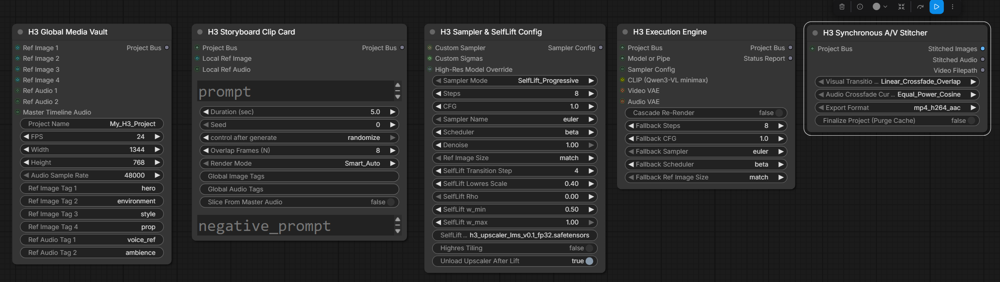
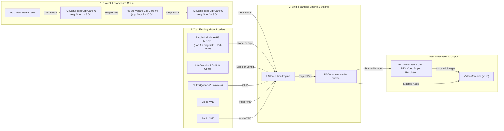

# Beginner's User Guide: Duffy MiniMax-H3 Multi-Clip Storyboard & A/V Stitching System

Welcome to the **Duffy MiniMax-H3 Storyboard Suite**! This guide walks you step-by-step through what each of the 5 new nodes does, how to wire them into your existing `Duffy-Fast-MiniMax-H3` workflow, and how to create long, multi-shot videos with synchronized audio—without ever having to re-render clips you already like.



---

## 1. The Big Picture (Why Use This System?)

Normally, **MiniMax-H3** can only generate a single clip up to **15 seconds** long. If you want to make a 30-second or 60-second video with multiple shots, doing it manually in ComfyUI is painful:
- Copying and pasting giant sampler groups eats up all your VRAM and turns your canvas into spaghetti.
- If you have a 4-clip video and you only want to tweak the prompt on **Clip 2**, a normal workflow forces you to wait for Clips 1, 3, and 4 to generate all over again.
- Stitching variable-length clips together manually often causes audio clicks or gradual lip-sync drift.

### How the Duffy H3 Storyboard Suite Solves This
Instead of duplicating heavy samplers, this system splits your workflow into **5 clean, modular nodes** (found in the **`Duffy/MiniMax-H3`** menu):

1. **H3 Global Media Vault** — Sets your project's resolution, frame rate, and stores reusable reference images/audio (like your main character `"hero"` or background `"environment"`).
2. **H3 Storyboard Clip Card** — A lightweight "index card" for a single shot (`1.0s` to `15.0s`). Need 5 shots in your video? Just drop 5 Clip Cards in a row and chain them together!
3. **H3 Sampler & SelfLift Config** — Holds your sampling settings (including **SelfLift Progressive Sampling** with `h3_upscaler_lms_v0.1_fp32.safetensors`).
4. **H3 Execution Engine** — The "brains" of the system. You connect your loaded MiniMax-H3 Model, CLIP, Video VAE, and Audio VAE here **just once**. It checks your hard drive cache and **only runs the GPU on clips that are new or changed**.
5. **H3 Synchronous A/V Stitcher** — Seamlessly blends the video overlaps, crossfades the stereo audio with zero lip-sync drift, saves your `.mp4`/`.mov`, and passes the full stitched video/audio to your downstream RTX Upscaler and `Video Combine` nodes.

---

## 2. Quick-Start Wiring Map (Left to Right)

Here is how the 5 nodes connect together from left to right on your canvas:



### What Does This Replace in Your Current `Duffy-Fast-MiniMax-H3.json` Workflow?

- **Keep your `Models` and `sparse_attention` groups** (`Load Diffusion Model` -> `Load LoRA` -> `MiniMax H3 Mem Eff Sage Attention Patch` -> `Model Attention Backend` -> `Model Sparse Attention`, plus `Load CLIP` and both `Load VAE` nodes).
- **Replace** the middle `Conditioning` (`MiniMax H3 Reference to Video`), `Group` (`SelfLift Progressive Sampler`), and raw `VAE Decode` / `VAE Decode Audio` nodes with the new **H3 Storyboard Chain -> H3 Execution Engine -> H3 Synchronous A/V Stitcher**.
- **Keep your right-hand `Decoding and Refinement` group** (`RTX Video Frame Generation` -> `RTX Video Super Resolution` -> `Video Combine`)—just plug `Stitched Images` into `RTX Video Frame Generation` and `Stitched Audio` into `Video Combine`!

---

## 3. Node-by-Node Guide (Every Input & Setting Explained)

### Node 1: `H3 Global Media Vault`
**Menu Location:** `Add Node` ➔ `Duffy` ➔ `MiniMax-H3` ➔ `Project` ➔ `H3 Global Media Vault`

Think of the Vault as your **Project Settings & Asset Library**. You put one Vault at the very start of your storyboard chain.

#### Inputs (Left Side)
| Input Port | Type | What to Connect Here |
|---|---|---|
| `Ref Image 1` .. `Ref Image 4` | `IMAGE` *(Optional)* | Connect character sheets, faces, environments, or props (e.g., from `Duffy Load Image & Resize`). Any size is fine—the Vault automatically resizes them to match your project canvas. |
| `Ref Audio 1` .. `Ref Audio 2` | `AUDIO` *(Optional)* | Connect voice reference clips or sound effect references. |
| `Master Timeline Audio` | `AUDIO` *(Optional)* | Connect a full song or continuous voiceover track if you want each clip in your storyboard to automatically slice its own matching time window from the master track. |

#### Settings (Widgets)
| Widget | Default | Explanation |
|---|---|---|
| `Project Name` | `My_H3_Project` | Creates a dedicated folder at `ComfyUI/output/H3_Projects/<Project Name>/` where all your rendered clips are cached safely on disk. Give each video project its own name! |
| `FPS` | `24` | Frame rate of your project. **Keep at `24`** for MiniMax-H3 (if you use 2x RTX Frame Generation afterwards, your final video will be `48` fps). |
| `Width` / `Height` | `1344` / `768` | Base generation resolution (16:9 widescreen at ~1MP). You can also use `960 x 544` (0.52MP) or `1024 x 576` (0.6MP) for faster generation before 2x RTX Super Resolution. |
| `Audio Sample Rate` | `48000` | Stereo audio sample rate (`48000` Hz is standard for video production). |
| `Ref Image Tag 1..4` | `hero`, `environment`, `style`, `prop` | Short nicknames for the images plugged into `Ref Image 1..4`. Any Clip Card can grab that image just by typing its nickname (like `hero`)! |
| `Ref Audio Tag 1..2` | `voice_ref`, `ambience` | Short nicknames for the audio plugged into `Ref Audio 1..2`. |

#### Output (Right Side)
- **`Project Bus`**: Connect this green wire into the **`Project Bus`** input of your first **`H3 Storyboard Clip Card`**.

---

### Node 2: `H3 Storyboard Clip Card`
**Menu Location:** `Add Node` ➔ `Duffy` ➔ `MiniMax-H3` ➔ `Storyboard` ➔ `H3 Storyboard Clip Card`

Each **Clip Card** represents **one shot** in your video.
- For a 1-shot video, use 1 Clip Card.
- For a 3-shot video, create 3 Clip Cards and daisy-chain them:
  `Vault (Project Bus)` ➔ `Clip Card 1 (Project Bus)` ➔ `Clip Card 2 (Project Bus)` ➔ `Clip Card 3 (Project Bus)` ➔ `H3 Execution Engine`.

#### Inputs (Left Side)
| Input Port | Type | What to Connect Here |
|---|---|---|
| `Project Bus` | `H3_PROJECT_BUS` *(Required)* | Connect from the `H3 Global Media Vault` (for Clip 1) or from the previous `H3 Storyboard Clip Card` (for Clips 2, 3, ...). |
| `Local Ref Image` | `IMAGE` *(Optional)* | An image used **only** in this specific shot. |
| `Local Ref Audio` | `AUDIO` *(Optional)* | An audio reference used **only** in this specific shot. |

#### Settings (Widgets)
| Widget | Default | Explanation |
|---|---|---|
| `prompt` | *(multiline text)* | Describe the action, camera movement, soundscape, and dialogue for this single shot. *(Tip: You can also right-click the node or connect a `Duffy Prompt Box` if you prefer a larger text editor).* |
| `Duration (sec)` | `5.0` | How long this clip should be, from **`1.0` to `15.0` seconds**. Every Clip Card can have a different duration (e.g., Clip 1 = `4.5s`, Clip 2 = `12.0s`, Clip 3 = `7.5s`). *(Behind the scenes, the engine automatically handles MiniMax-H3's `17k + 5` frame math and trims the output to your exact duration!)* |
| `Seed` | `0` | Random seed for this specific clip. **Important Tip:** Once you like a clip, set its `control after generate` right below `Seed` from `randomize` to **`fixed`** so its seed doesn't change on the next run! |
| `Overlap Frames (N)` | `8` | How many frames from the **end of the previous clip** are fed into the start of this clip for smooth visual and audio continuity.<br>• **Clip 1:** Automatically forced to `0` (since there is no previous clip).<br>• **Smooth Continuation (`6` to `12` frames):** Best when Shot 2 continues the motion/lighting of Shot 1.<br>• **Hard Scene Cut (`0` frames):** Set to `0` when jumping to a brand-new camera angle or location where you don't want frames blended from the previous shot. |
| `Render Mode` | `Smart_Auto` | Controls caching for this clip:<br>• **`Smart_Auto` (Default):** Automatically loads from disk cache if nothing on this card changed; automatically re-renders if you changed this card's prompt, duration, seed, or references.<br>• **`Force_ReRender`:** Forces this clip to re-generate on the next run no matter what.<br>• **`Lock_Cache`:** Freezes this clip so it **never** re-renders once cached, even if you tweak its prompt or change an earlier clip! |
| `Global Image Tags` | *(empty)* | Type the tag names from your Vault separated by commas (for example: `hero` or `hero, environment`). The images are passed to MiniMax-H3 in that exact order as `Picture 1`, `Picture 2`, etc. |
| `Global Audio Tags` | *(empty)* | Type audio tag names from your Vault (for example: `voice_ref`). |
| `Slice From Master Audio` | `false` | Turn **ON (`true`)** if you connected a song/narration to `Master Timeline Audio` on the Vault and want this clip to automatically receive its exact time slice. |
| `negative_prompt` | *(empty)* | Leave **empty** to use zeroed conditioning (recommended for FastH3 / Turbo LoRA), or type negative keywords for standard 30-step models. |

---

### Node 3: `H3 Sampler & SelfLift Config`
**Menu Location:** `Add Node` ➔ `Duffy` ➔ `MiniMax-H3` ➔ `Engine` ➔ `H3 Sampler & SelfLift Config`

This node configures how MiniMax-H3 samples each clip. Its defaults are **already pre-tuned to match your `Duffy-Fast-MiniMax-H3.json` workflow**!

#### Inputs (Left Side - All Optional)
- `Custom Sampler`: Optional `SAMPLER` wire (if you want to plug in `KSamplerSelect`). If left unconnected, uses the `Sampler Name` dropdown below.
- `Custom Sigmas`: Optional `SIGMAS` wire (if you want to plug in `BasicScheduler`). If left unconnected, calculates sigmas automatically from `Steps`, `Scheduler`, and `Denoise`.
- `High-Res Model Override`: Optional second `MODEL` if you want SelfLift's high-resolution stage to use a different LoRA stack than the low-resolution stage.

#### Settings (Widgets)
| Widget | Default (FastH3 Preset) | Explanation |
|---|---|---|
| `Sampler Mode` | `SelfLift_Progressive` | • **`SelfLift_Progressive`:** Uses `SelfLiftH3Sampler` (runs early steps at low resolution, lifts with the H3 latent upscaler, and finishes at full resolution—much faster!).<br>• **`Standard_KSampler`:** Runs all steps at full resolution using standard ComfyUI KSampler. |
| `Steps` | `8` | Total steps (`8` for FastH3 + 4-step Turbo LoRA). |
| `CFG` | `1.0` | Guidance scale (`1.0` for FastH3/Turbo LoRA). |
| `Sampler Name` | `euler` | Keep at `euler` when using `SelfLift_Progressive`. |
| `Scheduler` | `beta` | Noise schedule (`beta` is standard for MiniMax-H3). |
| `Denoise` | `1.00` | Keep at `1.00`. |
| `Ref Image Size` | `match` | `match` scales reference images to your generation canvas area (fast); `max` uses 2048px short edge (slower, maximum detail). |
| `SelfLift Transition Step` | `4` | Number of low-resolution steps before lifting to full resolution (`4` out of `8` steps). |
| `SelfLift Lowres Scale` | `0.40` | Resolution multiplier for the first 4 steps (`0.40`). |
| `SelfLift Rho` / `w_min` / `w_max` | `0.00` / `0.50` / `1.00` | SelfLift consistency correction weights (`Rho = 0.00` uses the fast external latent upscaler directly without a slow VAE round-trip). |
| `SelfLift Upscaler Model` | `h3_upscaler_lms_v0.1_fp32.safetensors` | The learned H3 latent upscaler model in `ComfyUI/models/latent_upscale_models/`. |
| `Highres Tiling` | `false` | Turn ON only if you run out of VRAM during the high-res pass. |
| `Unload Upscaler After Lift` | `true` | Frees the upscaler from VRAM immediately after step 4 so the high-res pass has maximum VRAM. |

---

### Node 4: `H3 Execution Engine`
**Menu Location:** `Add Node` ➔ `Duffy` ➔ `MiniMax-H3` ➔ `Engine` ➔ `H3 Execution Engine`

This node receives your storyboard chain and your MiniMax-H3 models, checks which clips are already cached on disk, and renders **only** the clips that need it.

#### Inputs (Left Side)
| Input Port | Type | What to Connect Here (From Your Existing Workflow) |
|---|---|---|
| `Project Bus` | `H3_PROJECT_BUS` *(Required)* | Connect from the **`Project Bus`** output of your **last `H3 Storyboard Clip Card`**. |
| `Model or Pipe` | `*` *(Required)* | Connect your patched **`MODEL`** (e.g., from `Get_model` or the output of `Model Sparse Attention`). It keeps all your Turbo LoRAs, `SageAttention`, `comfy kitchen attention`, and `sol-attn` patches 100% intact! |
| `Sampler Config` | `*` *(Optional)* | Connect from **`H3 Sampler & SelfLift Config`**. *(If left unconnected, the Engine uses its own `Fallback Steps/CFG/Sampler` widgets).* |
| `CLIP (Qwen3-VL minimax)` | `CLIP` *(Required)* | Connect your MiniMax-H3 **`CLIP`** (e.g., from `Get_clip` or `Load CLIP`). |
| `Video VAE` | `VAE` *(Required)* | Connect your **`Video VAE`** (`minimax_h3_video_vae_int8_convrot.safetensors` / `Get_video_vae`). |
| `Audio VAE` | `VAE` *(Required)* | Connect your **`Audio VAE`** (`minimax_h3_audio_vae_fp32.safetensors` / `Get_audio_vae`). |

#### Key Setting: `Cascade Re-Render` (`false` / `true`)
What happens if you have 3 clips with `Overlap Frames (N) = 8`, and you change the prompt of **Clip 2**?
- **When `Cascade Re-Render` is `false` (OFF - Default):**
  - Only **Clip 2** re-renders on the GPU.
  - **Clip 1** and **Clip 3** load instantly from disk cache!
  - Because Clip 2's ending frames changed, the Engine prints a helpful note in `Status Report` that Clip 3 is `[Continuity Warning: Out of Sync]`. This lets you preview and iterate on Clip 2 super fast without waiting for Clip 3 every time!
- **When `Cascade Re-Render` is `true` (ON):**
  - Once you are happy with Clip 2, flip `Cascade Re-Render` to **`true`** and run once: the Engine automatically re-renders **Clip 3** using Clip 2's brand-new ending frames so the transition between Clip 2 and Clip 3 is 100% seamless again!

#### Outputs (Right Side)
- **`Project Bus`**: Connect to **`H3 Synchronous A/V Stitcher`**.
- **`Status Report`**: Connect to a text preview node (like `Duffy Show Anything`) to see a clean summary of which clips were `[CACHED]` vs. `[RENDERED]`.

---

### Node 5: `H3 Synchronous A/V Stitcher`
**Menu Location:** `Add Node` ➔ `Duffy` ➔ `MiniMax-H3` ➔ `Output` ➔ `H3 Synchronous A/V Stitcher`

Loads all your rendered clips from the project cache, blends the video overlap seams, crossfades the stereo audio with zero sample drift, saves an `.mp4`/`.mov` file, and outputs the combined `IMAGE` and `AUDIO` streams.

#### Settings (Widgets)
| Widget | Default | Explanation |
|---|---|---|
| `Visual Transition Mode` | `Linear_Crossfade_Overlap` | How the $N$ overlap frames between Clip $i-1$ and Clip $i$ are combined:<br>• **`Linear_Crossfade_Overlap` (Recommended):** Smoothly dissolves across the $N$-frame overlap.<br>• **`Trim_Duplicate_Head`:** Keeps Clip $i-1$'s tail frames and trims the matching $N$ head frames off Clip $i$.<br>• **`Optical_Flow_Blend`:** Uses optical-flow motion warping across the $N$-frame overlap. |
| `Audio Crossfade Curve` | `Equal_Power_Cosine` | • **`Equal_Power_Cosine` (Recommended):** Constant-volume cosine/sine crossfade across the overlap window so volume never dips at the cut.<br>• **`Linear`:** Standard linear fade.<br>• **`Hard_Cut_At_Midpoint`:** Switches audio cleanly at the middle of the overlap with a tiny 2ms anti-click fade. *(Note: Even when `Overlap Frames = 0`, the stitcher applies a 5ms micro-fade so hard cuts never click or pop!)* |
| `Export Format` | `mp4_h264_aac` | • `mp4_h264_aac`: Standard H.264 MP4 with AAC stereo audio.<br>• `mp4_h265_aac`: HEVC/H.265 MP4.<br>• `mov_prores_pcm`: Apple ProRes MOV with uncompressed PCM audio for editing in DaVinci Resolve / Premiere. |
| `Finalize Project (Purge Cache)` | `false` | • **Keep `false` while working!** As long as this is `false`, a rolling preview is saved to `output/H3_Projects/<Project Name>/exports/preview_master.mp4` and **all your clip caches stay on disk** so you can keep tweaking individual clips.<br>• **Switch to `true` ONLY when your video is 100% finished:** It exports your final master to `ComfyUI/output/<Project Name>_final_<timestamp>.mp4` and **deletes** the temporary `cache/` and `vault/` folders to free up your hard drive space. |

#### Outputs (Right Side)
- **`Stitched Images` (`IMAGE`)**: The complete stitched video frames `[Total_Frames, H, W, 3]`. Connect this directly to **`RTX Video Frame Generation`** (or directly to `Video Combine` if not using RTX upscaling).
- **`Stitched Audio` (`AUDIO`)**: The complete synchronized stereo audio track. Connect this directly to the **`audio`** input of **`Video Combine (VHS)`**.
- **`Video Filepath` (`STRING`)**: The full disk path to the exported `.mp4`/`.mov` file.

---

## 4. Step-by-Step Walkthrough: Converting Your Existing Workflow

Let's look at how your existing single-clip workflow (`Duffy-Fast-MiniMax-H3.json`) maps to the new system:

### Step 1: Set Up Your Global Media Vault (Left Side)
In your existing workflow, you have `Load Image & Resize` (`picture_1 (13).jpeg`) and `Resolution Selector`.
1. Add an **`H3 Global Media Vault`** node.
2. Connect the `Image` output of your **`Load Image & Resize`** node directly into **`Ref Image 1`** on the Vault.
3. Leave **`Ref Image Tag 1`** set to `hero`.
4. Set **`Width`** and **`Height`** on the Vault to your desired base generation size (e.g., `1024` x `576` for 0.6MP or `1344` x `768` for 1.0MP), and **`FPS`** to `24`.

### Step 2: Chain Your Storyboard Clip Cards (Middle-Left)
Instead of putting `[Shot 1]`, `[Shot 2]`, and `[Shot 3]` inside one giant 10-second prompt, you can now give each shot its own dedicated **Clip Card** (up to 15 seconds *each*!):
1. Add **3 `H3 Storyboard Clip Card`** nodes side by side.
2. Wire `Vault (Project Bus)` ➔ `Clip Card 1 (Project Bus)` ➔ `Clip Card 2 (Project Bus)` ➔ `Clip Card 3 (Project Bus)`.
3. On **all 3 Clip Cards**:
   - Type **`hero`** into **`Global Image Tags`** (so `Picture 1` in your prompt refers to your Owl Knight character sheet on all 3 cards).
   - Set **`control after generate`** (right under `Seed`) to **`fixed`** so your clips stay cached between runs!
4. Set each card's duration and overlap:
   - **Clip Card 1 (Shot 1):** `Duration (sec) = 5.0`, `Overlap Frames (N) = 0`, paste your Shot 1 prompt.
   - **Clip Card 2 (Shot 2):** `Duration (sec) = 7.0`, `Overlap Frames (N) = 8`, paste your Shot 2 prompt.
   - **Clip Card 3 (Shot 3):** `Duration (sec) = 6.0`, `Overlap Frames (N) = 8`, paste your Shot 3 prompt.

### Step 3: Connect the Engine to Your Existing `Get_*` Nodes (Middle-Right)
In your existing workflow, you already have `Set_model`, `Set_clip`, `Set_video_vae`, and `Set_audio_vae`:
1. Add **`H3 Sampler & SelfLift Config`** and **`H3 Execution Engine`**.
2. Connect `Sampler Config` from **`H3 Sampler & SelfLift Config`** to **`H3 Execution Engine`**.
3. Connect the `Project Bus` output of **Clip Card 3** to **`Project Bus`** on **`H3 Execution Engine`**.
4. Connect your existing `Get_*` nodes to **`H3 Execution Engine`**:
   - `Get_model` ➔ `Model or Pipe`
   - `Get_clip` ➔ `CLIP (Qwen3-VL minimax)`
   - `Get_video_vae` ➔ `Video VAE`
   - `Get_audio_vae` ➔ `Audio VAE`

### Step 4: Stitch and Send to RTX Super Resolution & VHS (Right Side)
1. Add **`H3 Synchronous A/V Stitcher`** and connect `Project Bus` from **`H3 Execution Engine`** into it.
2. Connect **`Stitched Images`** from the Stitcher into the `images` input of your **`RTX Video Frame Generation`** node (which feeds into **`RTX Video Super Resolution`** and then into **`Video Combine`**).
3. Connect **`Stitched Audio`** from the Stitcher directly into the **`audio`** input of **`Video Combine (VHS)`**.

---

## 5. Common Workflows & Recipes

### Recipe A: Re-Rendering Just One Shot in the Middle of a Video
Suppose you just rendered a 4-clip video (Clips 1, 2, 3, and 4), and you love Clips 1, 3, and 4, but you want a different camera angle or better lip-sync in **Clip 2**:
1. Make sure `control after generate` under `Seed` is set to **`fixed`** on all 4 Clip Cards (so Clips 1, 3, and 4 don't pick new random seeds).
2. Change the `Seed` or `prompt` on **Clip Card 2** only.
3. Leave **`Cascade Re-Render`** set to **`false`** on `H3 Execution Engine` and click **Run**.
4. **Result:** Clips 1, 3, and 4 load from disk in less than a second! Only Clip 2 runs on the GPU, and the Stitcher immediately builds the updated full video.
5. Once you love the new Clip 2, if Clip 3 uses `Overlap Frames (N) > 0`, you can either:
   - Leave it as-is (the Stitcher's `Linear_Crossfade_Overlap` + `Equal_Power_Cosine` will crossfade the seam smoothly), **OR**
   - Toggle **`Cascade Re-Render`** to **`true`** for one run so Clip 3 re-generates using Clip 2's new ending frames!

### Recipe B: Locking a Favorite Clip Forever (`Lock_Cache`)
If you spent 10 tries getting **Clip 3** absolutely perfect and want to make sure you never accidentally overwrite it—even if you turn on `Cascade Re-Render` or accidentally bump its seed:
- Set **`Render Mode`** on Clip Card 3 to **`Lock_Cache`**.
- That clip is now 100% protected on disk until you switch it back to `Smart_Auto` or `Force_ReRender`.

### Recipe C: Using Multiple Global Reference Images
Want your character (`hero`) and a specific arena background (`environment`) in the same shot?
1. On **`H3 Global Media Vault`**, plug your character into `Ref Image 1` (tag: `hero`) and your background into `Ref Image 2` (tag: `environment`).
2. On **`H3 Storyboard Clip Card`**, set `Global Image Tags` to:
   ```text
   hero, environment
   ```
3. In that Clip Card's `prompt`, refer to them in the order you listed them:
   - `Picture 1` = `hero`
   - `Picture 2` = `environment`

---

## 6. Frequently Asked Questions & Troubleshooting

**Q: Why did ALL my clips re-render on the second run when I didn't touch the prompts?**
> **A:** Check the **`control after generate`** setting right below the **`Seed`** widget on each `H3 Storyboard Clip Card`! By default, ComfyUI sets new seed widgets to `randomize`, which changes the seed number after every run. Set `control after generate` to **`fixed`** on all your Clip Cards so their seeds stay constant unless you change them manually.

**Q: Can I turn on SageAttention, change BlockSparseAttention settings, or swap LoRAs without losing my cached clips?**
> **A:** **Yes!** The cache hash on each `H3 Storyboard Clip Card` is 100% isolated from your upstream model, LoRA, and attention nodes. If Clips 1 and 2 are already rendered and you add a new optimization or LoRA upstream to render Clip 3 faster, Clips 1 and 2 remain safely cached on disk. (If you *want* an existing clip to re-render with the new LoRA, just set its `Render Mode` to `Force_ReRender` for one run).

**Q: Where are my cached files stored on disk?**
> **A:** Inside your ComfyUI output directory under:
> `ComfyUI/output/H3_Projects/<Project Name>/`
> - `manifest.json`: Tracks clip hashes, frame counts, and sync status.
> - `vault/`: Cached reference images and audio.
> - `cache/`: Uncompressed `.safetensors` video frames and float32 `.wav` audio for each clip.
> - `exports/preview_master.mp4`: Rolling stitched video updated on every run.
>
> When you are completely done with a project, toggle **`Finalize Project (Purge Cache)`** to `true` on `H3 Synchronous A/V Stitcher` for one final run—it will copy your finished video into `ComfyUI/output/` and automatically delete the `cache/` and `vault/` folders to free up disk space.
